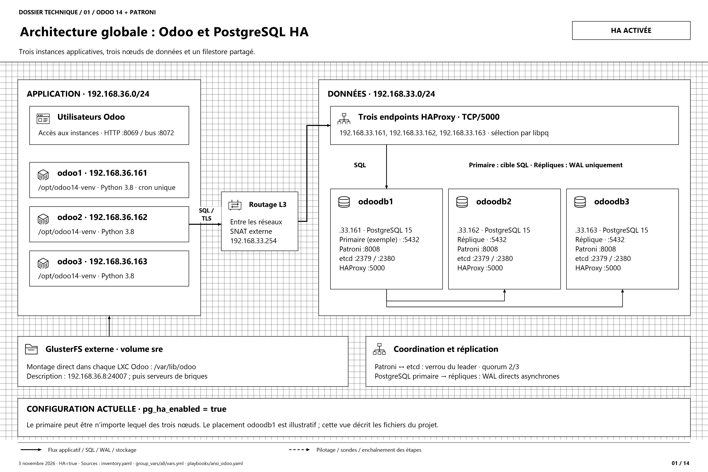
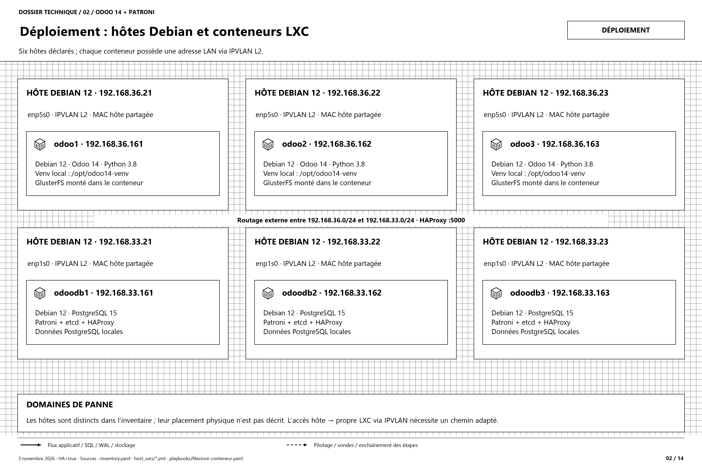
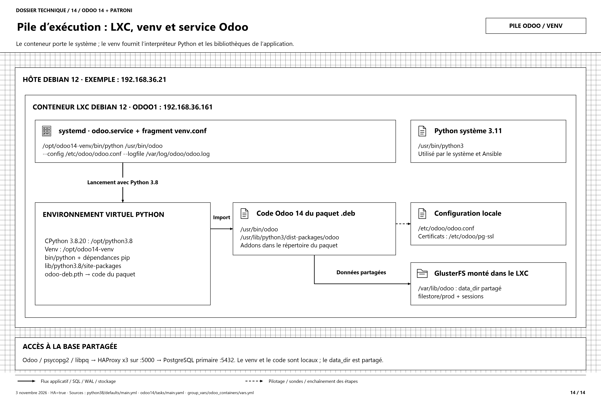
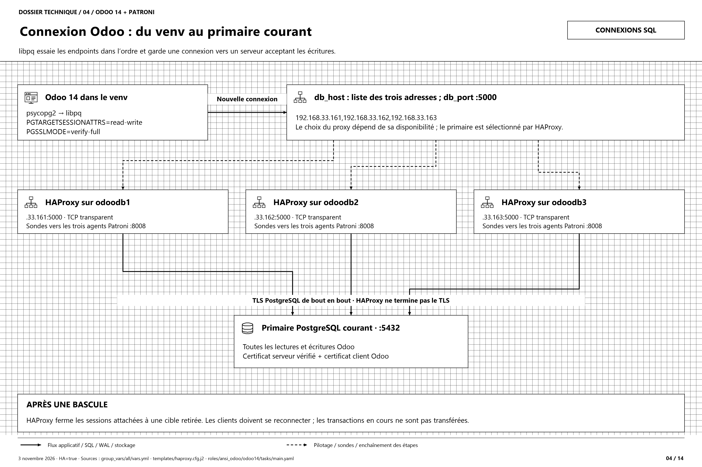
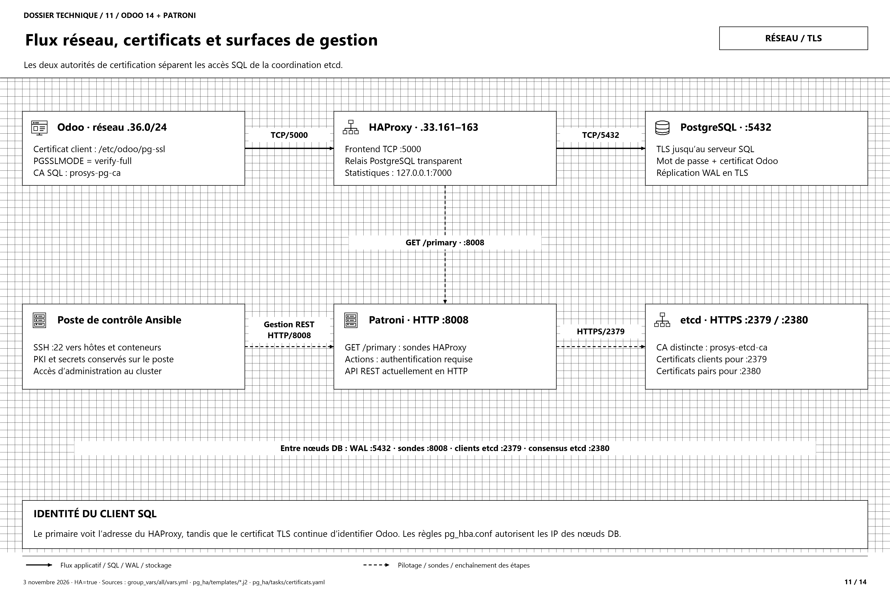
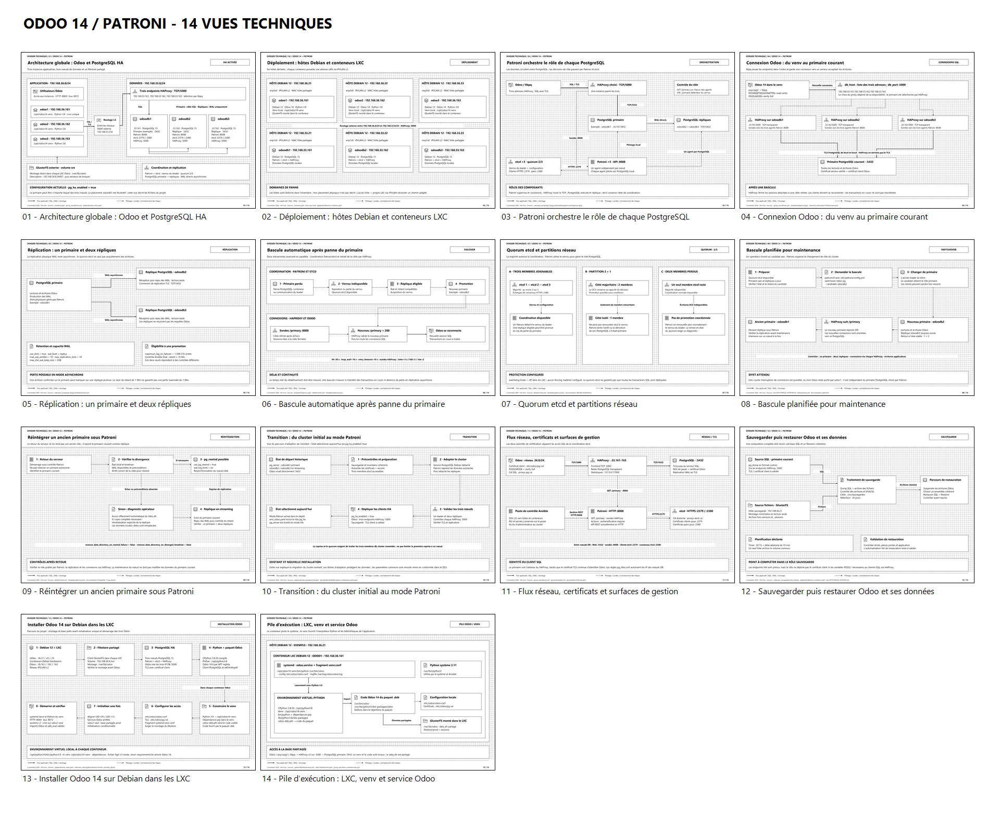
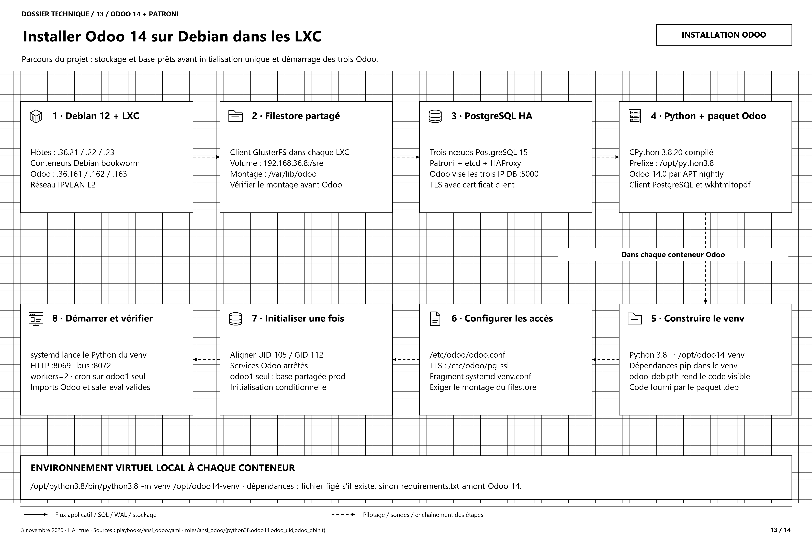
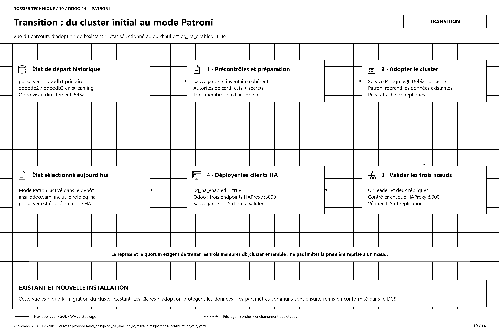
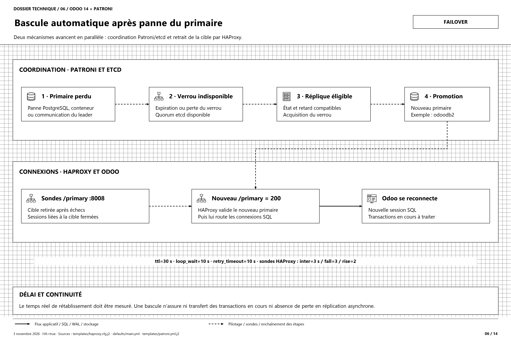
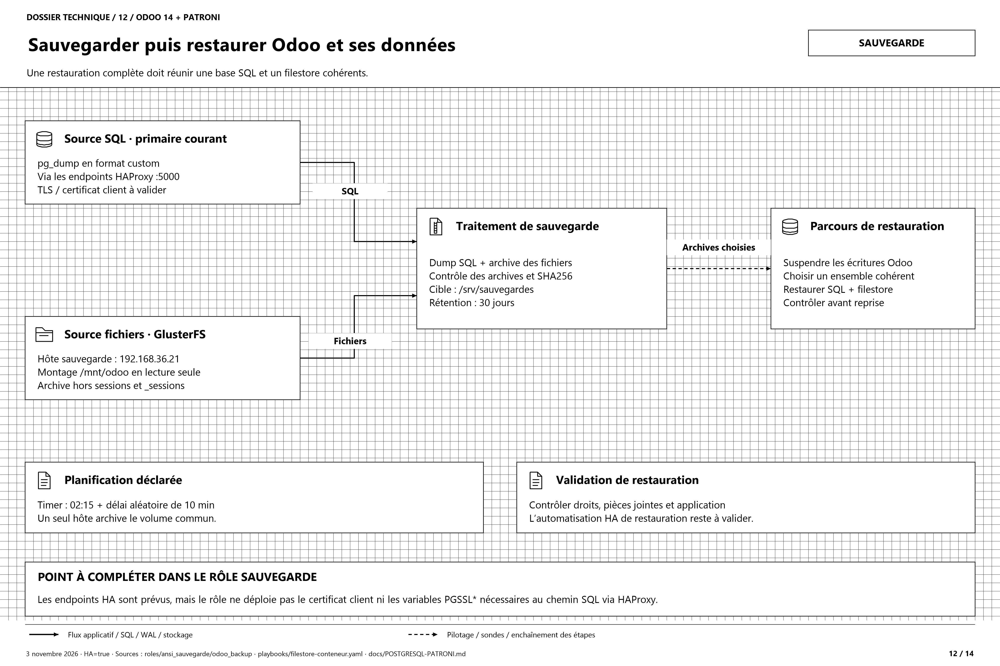

# ProSys — Odoo 14 en haute disponibilité sur LXC

Déploiement Ansible de trois instances **Odoo 14** qui partagent une base
**PostgreSQL 15** sous **Patroni**, ainsi qu'un filestore commun sur
**GlusterFS**. Chaque instance tourne dans un conteneur LXC Debian 12, posé
sur son propre hôte.

[](docs/schemas-patroni-odoo14/README.md)

> **Source de ce document.** Il décrit la configuration du dépôt au
> **3 novembre 2026** (`pg_ha_enabled: true` dans
> [group_vars/all/vars.yml](group_vars/all/vars.yml)). Il ne remplace pas un
> contrôle des serveurs. Les schémas sont détaillés dans
> [Schémas du projet](#schémas-du-projet).

---

## Architecture

### Machines et conteneurs

| Rôle | Conteneur LXC | IP du conteneur | Hôte | Carte de l'hôte |
|---|---|---|---|---|
| **odoo1** — Odoo, initialisation de la base, tâches planifiées | `devodoo14` | 192.168.36.161 | 192.168.36.21 | `enp5s0` |
| **odoo2** — Odoo | `devodoo14` | 192.168.36.162 | 192.168.36.22 | `enp5s0` |
| **odoo3** — Odoo | `devodoo14` | 192.168.36.163 | 192.168.36.23 | `enp5s0` |
| **odoodb1** — PostgreSQL, Patroni, etcd, HAProxy | `devpg15` | 192.168.33.161 | 192.168.33.21 | `enp1s0` |
| **odoodb2** — PostgreSQL, Patroni, etcd, HAProxy | `devpg15` | 192.168.33.162 | 192.168.33.22 | `enp1s0` |
| **odoodb3** — PostgreSQL, Patroni, etcd, HAProxy | `devpg15` | 192.168.33.163 | 192.168.33.23 | `enp1s0` |
| **supervision** — supervision (outils à installer) | `supervision` | 192.168.36.164 | 192.168.36.21 | `enp5s0` |

Éléments extérieurs au dépôt, que le déploiement suppose en place :

| Élément | Adresse | Usage |
|---|---|---|
| Volume GlusterFS répliqué `sre` | 192.168.36.8 (description du volume) | Filestore et sessions communs aux trois Odoo |
| Routeur entre 192.168.36.0/24 et 192.168.33.0/24 | passerelles `.254` | Fait du NAT : la base voit les Odoo sous 192.168.33.254 |
| Hôte de sauvegarde | 192.168.36.21 (`backup_host`) | `pg_dump` et archive du filestore dans `/srv/sauvegardes` |

Le placement est défini dans [inventory.yaml](inventory.yaml) et dans
[host_vars/](host_vars/). Les noms de groupes `gluster_servers` et
`gluster_bricks` sont **historiques** : aucun hôte du dépôt ne porte de
brique GlusterFS.



### Pile logicielle

| Couche | Choix | Raison |
|---|---|---|
| Hôtes et conteneurs | Debian 12 bookworm, LXC | Template `download` `-d debian -r bookworm` |
| Interpréteur d'Odoo | CPython **3.8.20** compilé dans `/opt/python3.8`, venv `/opt/odoo14-venv` | `safe_eval` d'Odoo 14 rejette le bytecode de Python 3.11 (opcode `RESUME`) |
| Odoo | Paquet `.deb` nightly 14.0, lancé par le Python du venv | Le Python 3.11 du système reste celui de Debian et d'Ansible |
| Base | PostgreSQL 15 de Debian, sous Patroni | Bascule automatique |
| Coordination | etcd, 3 membres, quorum de 2 | Verrou du primaire |
| Routage SQL | Un HAProxy par conteneur PostgreSQL, port 5000 | Conduit toujours au primaire du moment |
| Filestore | Client GlusterFS **dans** chaque conteneur Odoo, monté sur `/var/lib/odoo` | Commun aux trois instances, comme la base |



### Chemin d'une connexion SQL

1. Odoo reçoit `db_host = 192.168.33.161,192.168.33.162,192.168.33.163` et
   `db_port = 5000`. libpq essaie ces adresses dans l'ordre.
2. Avec `PGTARGETSESSIONATTRS=read-write`, libpq écarte toute adresse qui
   mènerait à un serveur en lecture seule.
3. Chaque HAProxy interroge `GET /primary` sur l'API Patroni (HTTP/8008) des
   trois serveurs. Seul le primaire répond `200`.
4. Le TLS va d'Odoo jusqu'au primaire sans terminaison intermédiaire :
   `verify-full`, avec certificat client. Le certificat de chaque serveur
   porte les trois adresses.

Comme le routeur fait du NAT, la base reconnaît chaque instance à son
**certificat client** et non à son adresse (`pg_nat_gateway_ips`).



### Réseau des conteneurs

Chaque conteneur est relié au LAN en **IPVLAN L2**, sur la carte de son hôte
(`lxc_net_type=ipvlan`) :

- le réseau des hôtes rejette les adresses MAC inconnues, si bien que
  macvlan et veth sur bridge n'obtiennent aucune réponse de la passerelle.
  IPVLAN réutilise la MAC de l'hôte ;
- l'hôte garde sa carte, qui porte sa route par défaut ;
- en contrepartie, **un hôte ne joint pas son propre conteneur**. Tous les
  tests se font depuis le poste de contrôle, ou avec `lxc-attach` sur l'hôte.

| Port | Flux |
|---|---|
| 22/TCP | Poste de contrôle → hôtes et conteneurs |
| 8069/TCP | Utilisateurs → chaque Odoo (interface web) |
| 8072/TCP | Utilisateurs → chaque Odoo (longpolling, bus de notifications) |
| 5000/TCP | Odoo et sauvegarde → les trois HAProxy |
| 5432/TCP | HAProxy → PostgreSQL ; réplication et `pg_rewind` entre serveurs |
| 8008/HTTP | HAProxy → API Patroni ; bascules |
| 2379, 2380/HTTPS | etcd : clients (Patroni) et échanges entre membres |
| 7000/HTTP | Page d'état HAProxy, sur `127.0.0.1` seulement |
| 24007 et 49152+/TCP | Conteneurs Odoo et hôte de sauvegarde → serveurs GlusterFS |

Aucun répartiteur HTTP n'est déployé : chaque utilisateur se connecte à
l'adresse d'une instance. Une configuration nginx est fournie à part
([nginx/odoo-repartition.conf](nginx/odoo-repartition.conf),
[docs/NGINX-REPARTITION-CHARGE.md](docs/NGINX-REPARTITION-CHARGE.md)), mais
aucun playbook ne l'installe.



### Filestore commun

Chaque conteneur Odoo monte **lui-même** `192.168.36.8:/sre` sur
`/var/lib/odoo` ([playbooks/filestore-conteneur.yaml](playbooks/filestore-conteneur.yaml)).
Le volume contient `filestore/prod` et `sessions`. Trois garde-fous :

- l'unité systemd d'Odoo exige le montage (`RequiresMountsFor`). Sans
  volume, Odoo ne démarre pas, au lieu d'écrire sur le disque local ;
- le rôle `odoo14` refuse de configurer une instance dont `/var/lib/odoo`
  n'est pas un montage GlusterFS ;
- le compte `odoo` porte le même UID et le même GID (105/112) sur les trois
  conteneurs (rôle `odoo_uid`). Sur un volume partagé, ce sont les numéros
  qui comptent.

L'ancien montage sur l'hôte puis bind vers le conteneur n'existe plus. Seul
l'hôte de sauvegarde garde `/mnt/odoo`, en **lecture seule**.

---

## Schémas du projet

[](docs/schemas-patroni-odoo14/README.md)

Le jeu de référence se trouve dans
[docs/schemas-patroni-odoo14/](docs/schemas-patroni-odoo14/README.md)
(édition du 3 novembre 2026). Chaque vue existe en trois formats : PNG
4800 × 3200 pour la lecture, SVG pour l'impression, draw.io pour la
modification. Le [dossier draw.io à 14 onglets](docs/schemas-patroni-odoo14/dossier-patroni-odoo14.drawio)
les rassemble ; le [dossier d'installation](docs/schemas-patroni-odoo14/installation-odoo14-debian-lxc.drawio)
reprend les vues 13 et 14.

| Nº | Schéma | Image | Vectoriel | Modifiable |
|---|---|---|---|---|
| 01 | Architecture globale : Odoo et PostgreSQL HA | [PNG](docs/schemas-patroni-odoo14/01-architecture-globale-ha.png) | [SVG](docs/schemas-patroni-odoo14/01-architecture-globale-ha.svg) | [draw.io](docs/schemas-patroni-odoo14/01-architecture-globale-ha.drawio) |
| 02 | Déploiement : hôtes Debian et conteneurs LXC | [PNG](docs/schemas-patroni-odoo14/02-deploiement-hotes-lxc.png) | [SVG](docs/schemas-patroni-odoo14/02-deploiement-hotes-lxc.svg) | [draw.io](docs/schemas-patroni-odoo14/02-deploiement-hotes-lxc.drawio) |
| 03 | Patroni orchestre le rôle de chaque PostgreSQL | [PNG](docs/schemas-patroni-odoo14/03-orchestration-patroni.png) | [SVG](docs/schemas-patroni-odoo14/03-orchestration-patroni.svg) | [draw.io](docs/schemas-patroni-odoo14/03-orchestration-patroni.drawio) |
| 04 | Connexion Odoo : du venv au primaire courant | [PNG](docs/schemas-patroni-odoo14/04-connexion-odoo-haproxy.png) | [SVG](docs/schemas-patroni-odoo14/04-connexion-odoo-haproxy.svg) | [draw.io](docs/schemas-patroni-odoo14/04-connexion-odoo-haproxy.drawio) |
| 05 | Réplication : un primaire et deux répliques | [PNG](docs/schemas-patroni-odoo14/05-replication-postgresql.png) | [SVG](docs/schemas-patroni-odoo14/05-replication-postgresql.svg) | [draw.io](docs/schemas-patroni-odoo14/05-replication-postgresql.drawio) |
| 06 | Bascule automatique après panne du primaire | [PNG](docs/schemas-patroni-odoo14/06-bascule-automatique.png) | [SVG](docs/schemas-patroni-odoo14/06-bascule-automatique.svg) | [draw.io](docs/schemas-patroni-odoo14/06-bascule-automatique.drawio) |
| 07 | Quorum etcd et partitions réseau | [PNG](docs/schemas-patroni-odoo14/07-quorum-et-partitions.png) | [SVG](docs/schemas-patroni-odoo14/07-quorum-et-partitions.svg) | [draw.io](docs/schemas-patroni-odoo14/07-quorum-et-partitions.drawio) |
| 08 | Bascule planifiée pour maintenance | [PNG](docs/schemas-patroni-odoo14/08-bascule-planifiee.png) | [SVG](docs/schemas-patroni-odoo14/08-bascule-planifiee.svg) | [draw.io](docs/schemas-patroni-odoo14/08-bascule-planifiee.drawio) |
| 09 | Réintégrer un ancien primaire sous Patroni | [PNG](docs/schemas-patroni-odoo14/09-retour-ancien-primaire.png) | [SVG](docs/schemas-patroni-odoo14/09-retour-ancien-primaire.svg) | [draw.io](docs/schemas-patroni-odoo14/09-retour-ancien-primaire.drawio) |
| 10 | Transition : du cluster initial au mode Patroni | [PNG](docs/schemas-patroni-odoo14/10-transition-vers-patroni.png) | [SVG](docs/schemas-patroni-odoo14/10-transition-vers-patroni.svg) | [draw.io](docs/schemas-patroni-odoo14/10-transition-vers-patroni.drawio) |
| 11 | Flux réseau, certificats et surfaces de gestion | [PNG](docs/schemas-patroni-odoo14/11-flux-reseau-et-tls.png) | [SVG](docs/schemas-patroni-odoo14/11-flux-reseau-et-tls.svg) | [draw.io](docs/schemas-patroni-odoo14/11-flux-reseau-et-tls.drawio) |
| 12 | Sauvegarder puis restaurer Odoo et ses données | [PNG](docs/schemas-patroni-odoo14/12-sauvegarde-et-restauration.png) | [SVG](docs/schemas-patroni-odoo14/12-sauvegarde-et-restauration.svg) | [draw.io](docs/schemas-patroni-odoo14/12-sauvegarde-et-restauration.drawio) |
| 13 | Installer Odoo 14 sur Debian dans les LXC | [PNG](docs/schemas-patroni-odoo14/13-installation-odoo14-debian-lxc.png) | [SVG](docs/schemas-patroni-odoo14/13-installation-odoo14-debian-lxc.svg) | [draw.io](docs/schemas-patroni-odoo14/13-installation-odoo14-debian-lxc.drawio) |
| 14 | Pile d'exécution : LXC, venv et service Odoo | [PNG](docs/schemas-patroni-odoo14/14-pile-execution-odoo14-venv.png) | [SVG](docs/schemas-patroni-odoo14/14-pile-execution-odoo14-venv.svg) | [draw.io](docs/schemas-patroni-odoo14/14-pile-execution-odoo14-venv.drawio) |

Les schémas se régénèrent depuis PowerShell sous Windows. Le générateur ne
contacte aucun serveur :

```powershell
powershell.exe -NoProfile -ExecutionPolicy Bypass -File .\docs\schemas-patroni-odoo14\generer-schemas.ps1
```

### Rapport du projet

[Rapport Word (DOCX)](docs/rapport-projet-odoo14/Rapport-ProSys-Odoo14-Architecture-Fonctionnement.docx) ·
[Version PDF](docs/rapport-projet-odoo14/Rapport-ProSys-Odoo14-Architecture-Fonctionnement.pdf) ·
[Présentation et génération](docs/rapport-projet-odoo14/README.md).
Le rapport contient 27 figures et 12 schémas textuels. Il couvre le
fonctionnement applicatif d'Odoo, Debian/LXC/venv,
PostgreSQL/Patroni/etcd/HAProxy, GlusterFS, la maintenance et les
sauvegardes.

### Éditions précédentes

Ces vues décrivent des états antérieurs du dépôt : HA désactivée, GlusterFS
monté sur l'hôte puis bindé dans le conteneur. Elles sont conservées pour
l'historique. En cas de divergence, l'édition du 3 novembre fait foi.

| Thème | Date | Images | Dossier |
|---|---|---|---|
| Architecture et HA PostgreSQL | 25 oct. 2026 | [Architecture expert](docs/schemas-architecture-ha/01-architecture-actuelle.png) · [Réplication et bascule manuelle](docs/schemas-architecture-ha/02-replication-et-bascule-manuelle.png) · [Option HA Patroni/etcd/HAProxy](docs/schemas-architecture-ha/03-option-ha-patroni-etcd-haproxy.png) · [Bascule HA et quorum](docs/schemas-architecture-ha/04-bascule-ha-et-quorum.png) | [schemas-architecture-ha](docs/schemas-architecture-ha/README.md) |
| Orchestration Patroni / HAProxy | 25 oct. 2026 | [PostgreSQL, Patroni, etcd, HAProxy](docs/schemas-patroni/orchestration-patroni-haproxy-postgresql.png) | [schemas-patroni](docs/schemas-patroni/README.md) |
| Réseau LXC (IPVLAN) | 18 oct. 2026 | [Raccordement IPVLAN](docs/schemas-lxc/01-raccordement-ipvlan.png) · [Accès utilisateur](docs/schemas-lxc/02-acces-utilisateur-odoo.png) · [Flux Odoo → PostgreSQL](docs/schemas-lxc/03-flux-odoo-postgresql.png) | [schemas-lxc](docs/schemas-lxc/README.md) |
| GlusterFS | 18 oct. 2026 | [Volume partagé](docs/schemas-glusterfs/01-volume-partage-trois-odoo.png) · [Montage hôte et bind LXC](docs/schemas-glusterfs/02-montage-hote-et-bind-lxc.png) · [GlusterFS et sauvegarde](docs/schemas-glusterfs/03-glusterfs-et-sauvegarde.png) | [schemas-glusterfs](docs/schemas-glusterfs/README.md) |
| Architecture d'origine | 16 oct. 2026 | [Architecture (version initiale)](docs/architecture-actuelle.png) · [Réseau LXC historique](docs/rapport-projet-odoo14/architecture-reseau-lxc-historique.png) | [ARCHITECTURE-ACTUELLE.md](docs/ARCHITECTURE-ACTUELLE.md) |

---

## Structure du dépôt

Les rôles sont rangés par playbook, sous `roles/<playbook>/<rôle>`. Le
`roles_path` de [ansible.cfg](ansible.cfg) les trouve tous par leur seul
nom.

```
inventory.yaml                 Hôtes, conteneurs et groupes (seul inventaire)
ansible.cfg                    Inventaire, roles_path, SSH
requirements.yml               Collections Ansible, versions épinglées
.env.example                   Modèle des variables d'environnement (sans secret)
group_vars/
  all/vars.yml                 pg_ha_enabled, accès à la base, TLS, GlusterFS
  all/vault.yml.example        Modèle des secrets à chiffrer
  odoo_containers/  odoo_primary/  db_containers/  db_replicas/
  backup_host/  gluster_bricks/
host_vars/192.168.3x.2x.yml    Conteneur, carte, IP, passerelle, DNS par hôte
common/group_vars/local_dev.yml  Liste des conteneurs à créer par hôte
playbooks/
  ansi2-snapchot.yaml          Création des conteneurs LXC Debian 12
  reseau-lxc.yaml              IPVLAN et amorçage SSH des conteneurs
  ansi_odoo.yaml               Déploiement complet (horloge → base → Odoo)
  filestore-conteneur.yaml     Montage GlusterFS par les conteneurs Odoo
  ansi_postgresql_ha.yaml      Reprise par Patroni, remise en conformité
  ansi_syncro.yaml             Migration des pièces jointes base ↔ filestore
  nettoyage_odoo.yaml          Réparation APT, reset optionnel
  nettoyage.yaml               Désinstallation de LXC sur les hôtes
roles/
  ansi2-snapchot/install       Paquets LXC, création des conteneurs
  reseau-lxc/lxc_lan           Réseau IPVLAN, openssh, python3, clé du contrôleur
  ansi_odoo/chrony             Horloge des hôtes
  ansi_odoo/pg_server          PostgreSQL sans Patroni (pg_ha_enabled: false)
  ansi_odoo/python38           Compilation de CPython 3.8.20
  ansi_odoo/odoo14             Paquet Odoo, venv, odoo.conf, unité systemd
  ansi_odoo/odoo_uid           UID/GID communs du compte odoo
  ansi_odoo/odoo_dbinit        « odoo -i base », sur odoo1 seul
  ansi_postgresql_ha/pg_ha     Patroni, etcd, HAProxy, certificats
  filestore-conteneur/filestore_conteneur  Client GlusterFS, /dev/fuse
  ansi_sauvegarde/odoo_backup  pg_dump, archive du filestore, timer systemd
  ansi_syncro/odoo_migration   Étapes de la migration des pièces jointes
  commun/base_debian           Sources APT cohérentes, réalignement des paquets
  commun/pg_pki                Autorité et certificats PostgreSQL
  nettoyage*/                  Nettoyage des conteneurs et des hôtes
  inutilises/                  Anciens rôles, conservés pour mémoire
docs/                          Documentation, schémas et rapport
nginx/                         Répartiteur HTTP optionnel, non déployé
scripts/                       Script réseau IPVLAN manuel
```

Le rôle de chaque fichier est expliqué dans
[docs/EXPLICATION-DES-FICHIERS.md](docs/EXPLICATION-DES-FICHIERS.md).

---

## Prérequis

### Poste de contrôle

```bash
sudo apt install -y ansible git openssh-client sshpass
ansible --version                                   # doit être 2.10.x
ansible-galaxy collection install -r requirements.yml
```

`ansible.posix 1.1.1` déclare `requires_ansible: >=2.9,<2.11`. Avec un
Ansible plus récent, la collection refuse de se charger. Les versions
épinglées (`community.general 1.3.6`, `community.postgresql 1.1.1`,
`ansible.posix 1.1.1`) sont celles validées par le déploiement complet du
21 septembre 2026. Détails : [docs/POSTE-CONTROLE-UBUNTU-DEBIAN.md](docs/POSTE-CONTROLE-UBUNTU-DEBIAN.md).

### Accès SSH par clé

Le rôle `lxc_lan` injecte dans les conteneurs la clé `~/.ssh/id_rsa.pub`, ou
celle donnée par `PROSYS_CONTROLLER_SSH_PUBKEY`.

```bash
ls ~/.ssh/id_rsa.pub || ssh-keygen -t rsa -b 4096
for h in 36.21 36.22 36.23 33.21 33.22 33.23; do ssh-copy-id root@192.168.$h; done
ansible gluster_servers -m ping
```

### Secrets et autorité de certification

```bash
cp group_vars/all/vault.yml.example group_vars/all/vault.yml
$EDITOR group_vars/all/vault.yml
ansible-vault encrypt group_vars/all/vault.yml
```

| Secret | Usage |
|---|---|
| `vault_odoo_admin_password` | Mot de passe **maître** d'Odoo (gestion des bases) |
| `vault_odoo_db_password` | Rôle PostgreSQL `odoo`, partagé par la base et les Odoo |
| `vault_pg_replication_password` | Rôle `replicator` (flux WAL) |
| `vault_pg_patroni_superuser_password` | Superutilisateur `postgres`, pour `pg_rewind` (12 caractères minimum) |
| `vault_pg_patroni_rest_password` | Compte `patroni` de l'API REST (12 caractères minimum) |

Le répertoire `pki/` est créé sur le poste de contrôle et **exclu du dépôt**.
Il contient l'autorité PostgreSQL (`ca.key`) et, à part, celle d'etcd
(`pki/etcd/`). Il faut le sauvegarder comme le vault. Le rôle `pg_ha` refuse
de créer une nouvelle autorité, car Odoo rejetterait alors tous les
serveurs : il faut toujours lancer les playbooks depuis le poste qui détient
`pki/`.

### Variables d'environnement

```bash
cp .env.example .env && $EDITOR .env
set -a && source .env && set +a      # à refaire dans chaque nouveau terminal
```

| Variable | Effet |
|---|---|
| `ANSIBLE_*` | Réglages Ansible ; ils priment sur `ansible.cfg` |
| `ANSIBLE_VAULT_PASSWORD_FILE` | Remplace `--ask-vault-pass` (fichier hors dépôt, `chmod 600`) |
| `PROSYS_ODOO_VERSION` | Version d'Odoo, `14.0` par défaut |
| `PROSYS_ODOO_DB` | Nom de la base partagée, `prod` par défaut |
| `PROSYS_CONTROLLER_SSH_PUBKEY` | Clé publique injectée dans les conteneurs |

Les mots de passe restent dans `vault.yml`, **jamais** dans `.env`.

### Hors du dépôt

- Le volume GlusterFS `sre` est démarré et accepte les adresses des
  conteneurs Odoo (`gluster volume get sre auth.allow`). Les conteneurs
  joignent 24007 et les ports de brique (`gluster volume status sre`).
- Les ports du tableau [Réseau des conteneurs](#réseau-des-conteneurs) sont
  ouverts, en particulier 5000 du réseau Odoo vers les trois conteneurs
  PostgreSQL.

---

## Déploiement

L'ordre est contraignant. Toutes les commandes se lancent depuis la racine
du dépôt.

| Étape | Commande | Effet |
|---|---|---|
| 1 | `ansible-playbook playbooks/ansi2-snapchot.yaml` | Crée `devodoo14` ou `devpg15` sur chaque hôte |
| 2 | `ansible-playbook playbooks/reseau-lxc.yaml --check --diff`, puis sans option | Pose l'IPVLAN et amorce SSH ; **redémarre les conteneurs** |
| 3 | `ansible-playbook playbooks/ansi_odoo.yaml --ask-vault-pass` | Déploie la base, puis Odoo |

Détail de `ansi_odoo.yaml` :

| Play | Cible | Effet |
|---|---|---|
| 0/5 | localhost | Contrôle des versions d'Ansible et des collections. Tag `never` : `--tags all,preflight` pour le jouer |
| 1/5 | hôtes | Horloge (`chrony`). Une horloge fausse fait échouer `apt` |
| 1bis/5 | conteneurs Odoo, puis hôtes un par un | Montage GlusterFS par les conteneurs (`filestore-conteneur.yaml`) |
| 2/5, 2bis/5 | `db_containers`, `db_replicas` | `pg_server` : **sautées** quand `pg_ha_enabled: true` |
| 2ter/5 | `db_cluster` | `pg_ha` : Patroni, etcd et HAProxy, sur les trois serveurs ensemble |
| 3/5 | `odoo_containers` | Python 3.8, Odoo 14, `odoo.conf`, UID communs. Service **laissé arrêté** |
| 4/5 | `odoo_primary` | `odoo -i base` sur la base partagée, par **odoo1 seul** |
| 5/5 | `odoo_containers` | Démarrage des trois instances, attente du port 8069 |

Trois `odoo -i base` concurrents sur la même base corrompraient le
registre. C'est pour cela que l'initialisation (4/5) précède le démarrage
commun (5/5).



### Passage à Patroni sur un cluster existant

Le dépôt documente Patroni comme la **reprise** d'un cluster installé
d'abord par `pg_server` : `odoodb1` primaire, `odoodb2` et `odoodb3` en
streaming. La reprise se fait sans recopie. La séquence documentée :

1. `pg_ha_enabled: false`, puis `ansi_odoo.yaml` (cluster `pg_server`) ;
2. sauvegarde de la base ;
3. `ansible-playbook playbooks/ansi_postgresql_ha.yaml --ask-vault-pass` ;
4. **sans attendre**, `pg_ha_enabled: true`, puis rejouer `ansi_odoo.yaml`.
   Sinon, après une bascule, Odoo resterait sur un serveur en lecture seule.

Ne jamais utiliser `--limit` avec `ansi_postgresql_ha.yaml` : etcd et la
reprise exigent les trois serveurs ensemble. Rejoué, le playbook ne fait que
vérifier et remettre en conformité, sans coupure. Procédure complète,
retour arrière et dépannage : [docs/POSTGRESQL-PATRONI.md](docs/POSTGRESQL-PATRONI.md).



### Rejouer une partie

```bash
ansible-playbook playbooks/ansi_odoo.yaml --ask-vault-pass --tags horloge     # horloge seule
ansible-playbook playbooks/ansi_odoo.yaml --ask-vault-pass --tags filestore   # montage GlusterFS seul
ansible-playbook playbooks/ansi_odoo.yaml --tags preflight                    # contrôle du poste seul
ansible-playbook playbooks/reseau-lxc.yaml --limit 192.168.36.21              # réseau d'un seul hôte
```

---

## Vérification

Depuis le poste de contrôle (un hôte ne joint pas son propre conteneur) :

```bash
# Odoo actif sur les trois conteneurs
ansible odoo_containers -m shell -a 'systemctl is-active odoo'

# /var/lib/odoo est bien le volume GlusterFS (attendu : fuse.glusterfs 192.168.36.8:/sre)
ansible odoo_containers -m shell -a 'findmnt -n -o FSTYPE,SOURCE /var/lib/odoo'

# un Leader et deux Replica en streaming, retard proche de 0
ansible odoodb1 -m shell -a 'patronictl -c /etc/patroni/config.yml list'

# interface web des trois instances (attendu : 200)
for i in 161 162 163; do curl -sI -o /dev/null -w "$i -> %{http_code}\n" \
  http://192.168.36.$i:8069/web/login; done
```

Connexion : **`admin` / `admin`**. C'est le compte que crée `-i base`, et
son mot de passe est à changer dès la première connexion. Le
`vault_odoo_admin_password` est le mot de passe **maître** de gestion des
bases, pas celui de l'utilisateur. Le gestionnaire de bases web est
désactivé (`list_db = false`).

---

## Exploitation

Commandes à lancer sur un conteneur PostgreSQL :

| Besoin | Commande |
|---|---|
| État du cluster | `patronictl -c /etc/patroni/config.yml list` |
| Bascule planifiée | `patronictl -c /etc/patroni/config.yml switchover odoo-pg --candidate odoodb2` |
| Redémarrer PostgreSQL | `patronictl -c /etc/patroni/config.yml restart odoo-pg` |
| Recopier une réserve | `patronictl -c /etc/patroni/config.yml reinit odoo-pg odoodb3` |
| Journal de Patroni | `journalctl -u patroni -f` |
| Page d'état HAProxy | `ssh -L 7000:127.0.0.1:7000 root@192.168.33.161`, puis <http://127.0.0.1:7000/> |

- C'est Patroni qui démarre et arrête PostgreSQL. **Ne plus** utiliser
  `systemctl restart postgresql`, `pg_ctlcluster` ni `pg_ctl` : l'unité
  Debian est masquée.
- Un paramètre commun se change dans `pg_ha_dcs`
  ([roles/ansi_postgresql_ha/pg_ha/defaults/main.yml](roles/ansi_postgresql_ha/pg_ha/defaults/main.yml)),
  puis on rejoue le playbook. `patronictl edit-config` serait écrasé au
  passage suivant.
- `/etc/patroni/config.yml` ne se corrige pas à la main : rejouer le
  playbook, qui relance Patroni en pause si la liste etcd a changé.



Les autres scénarios ont chacun leur vue : [quorum et partitions](docs/schemas-patroni-odoo14/07-quorum-et-partitions.png),
[bascule planifiée](docs/schemas-patroni-odoo14/08-bascule-planifiee.png),
[réintégration d'un ancien primaire](docs/schemas-patroni-odoo14/09-retour-ancien-primaire.png).

### Migration des pièces jointes

[playbooks/ansi_syncro.yaml](playbooks/ansi_syncro.yaml) déplace les pièces
jointes de la base vers le filestore, ou l'inverse avec
`-e odoo_attachment_location=db`. **Le service est coupé** du play 2 au
play 8. L'état des lieux seul ne coupe rien :

```bash
ansible-playbook playbooks/ansi_syncro.yaml -k --ask-vault-pass --tags preflight
```

### Nettoyage

```bash
# réparation APT dans les conteneurs Odoo, non destructif
ansible-playbook playbooks/nettoyage_odoo.yaml --ask-vault-pass

# DESTRUCTIF : supprime la base et le filestore
ansible-playbook playbooks/nettoyage_odoo.yaml --ask-vault-pass -e full_reset=true

# DESTRUCTIF : désinstalle LXC et détruit les conteneurs
ansible-playbook playbooks/nettoyage.yaml
```

---

## Sauvegarde

Le rôle [odoo_backup](roles/ansi_sauvegarde/odoo_backup/) s'exécute sur
l'hôte de sauvegarde 192.168.36.21. Il fait un `pg_dump` de la base, puis
une archive de `/mnt/odoo` sans les sessions, et range le tout dans
`/srv/sauvegardes`. Un timer systemd le déclenche chaque jour à 02:15 (délai
aléatoire de 10 minutes). La rétention est de 30 jours, et chaque sauvegarde
est relue juste après son écriture. La procédure de restauration est décrite
dans [docs/sauvegarde-restauration.md](docs/sauvegarde-restauration.md).



> **À compléter avant de compter sur la sauvegarde :**
>
> - le playbook `playbooks/ansi_sauvegarde.yaml` a été **supprimé** au commit
>   `d886db6`, alors que `group_vars/`, `ansi_postgresql_ha.yaml` et le rôle
>   `pg_ha` y renvoient encore. Pour le récupérer :
>   `git checkout d886db6~1 -- playbooks/ansi_sauvegarde.yaml` ;
> - avec `pg_ha_enabled: true`, `pg_dump` passe par HAProxy, qui exige un
>   certificat client. Le rôle prépare les adresses HA et `.pgpass`, mais ne
>   déploie ni le certificat ni les variables `PGSSL*` : le dump sera refusé
>   tant que ce point n'est pas traité.

---

## Limites connues

- **Pas de chien de garde matériel** : un conteneur LXC n'a pas de
  `/dev/watchdog`. Un Patroni bloqué sans planter laisserait l'ancien
  primaire accepter des écritures pendant la promotion d'une réserve.
- **Réplication asynchrone** : lors d'une bascule non planifiée, des
  transactions récentes peuvent être perdues. `maximum_lag_on_failover`
  (1 Mio) est un seuil d'éligibilité ; il ne garantit pas une perte
  maximale. Les transactions en cours ne sont pas transférées et les
  clients doivent se reconnecter.
- **Quorum etcd de 2 sur 3** : la perte d'un serveur est tolérée. Si deux
  serveurs sont perdus, le dernier passe en lecture seule, et Odoo s'arrête
  par conception.
- **La HA concerne la base seulement.** Le cron d'Odoo reste sur odoo1, les
  accès web visent chacun une instance, et le volume GlusterFS ainsi que
  l'infrastructure physique sont hors du dépôt.
- **Groupes d'inventaire** : après une bascule, `db_containers` (odoodb1) et
  `db_replicas` ne décrivent plus que le placement d'origine. Or
  `ansi_syncro.yaml` et `odoo_cleanup` traitent `db_containers` comme « la »
  base : il faut les vérifier avant de les lancer.
- **Fins de vie** : Odoo 14 n'est plus maintenu, et Python 3.8 ne reçoit plus
  de correctifs depuis octobre 2024. L'interpréteur est confiné à `/opt` et
  ne sert qu'à Odoo.
- **Commentaires anciens** : certains en-têtes (`ansi_odoo.yaml`,
  `.env.example`, `group_vars/all/vars.yml`) citent encore les adresses
  192.168.96.x et les hôtes Rocky de l'ancien lab. L'inventaire fait foi.

---

## Documentation

| Document | Contenu |
|---|---|
| [docs/POSTGRESQL-PATRONI.md](docs/POSTGRESQL-PATRONI.md) | Patroni, etcd, HAProxy : fonctionnement, mise en place, exploitation, dépannage |
| [docs/schemas-patroni-odoo14/README.md](docs/schemas-patroni-odoo14/README.md) | Catalogue et lecture des 14 schémas |
| [docs/rapport-projet-odoo14/README.md](docs/rapport-projet-odoo14/README.md) | Rapport DOCX/PDF du projet |
| [docs/EXPLICATION-DES-PLAYBOOKS.md](docs/EXPLICATION-DES-PLAYBOOKS.md) | Chaque playbook, son ordre et ses raisons (état du 25 sept. 2026) |
| [docs/EXPLICATION-DES-FICHIERS.md](docs/EXPLICATION-DES-FICHIERS.md) | Rôle de chaque fichier du dépôt |
| [docs/PERIMETRE-ANSIBLE.md](docs/PERIMETRE-ANSIBLE.md) | Ce qu'Ansible gère, vérifie, ou laisse manuel |
| [docs/sauvegarde-restauration.md](docs/sauvegarde-restauration.md) | Procédure de sauvegarde et de restauration |
| [docs/BOOTSTRAP-CONTENEUR-MANUEL.md](docs/BOOTSTRAP-CONTENEUR-MANUEL.md) | Amorçage manuel d'un conteneur, commande par commande |
| [docs/POSTE-CONTROLE-UBUNTU-DEBIAN.md](docs/POSTE-CONTROLE-UBUNTU-DEBIAN.md) | Préparer le poste de contrôle |
| [docs/NGINX-REPARTITION-CHARGE.md](docs/NGINX-REPARTITION-CHARGE.md) | Répartiteur HTTP optionnel |
| [docs/ARCHITECTURE.md](docs/ARCHITECTURE.md), [docs/ARCHITECTURE-ACTUELLE.md](docs/ARCHITECTURE-ACTUELLE.md) | Architecture historique (16 oct. 2026) |
| [README1.md](README1.md) | Ancienne procédure de déploiement depuis un autre poste (adressage 192.168.96.x) |
