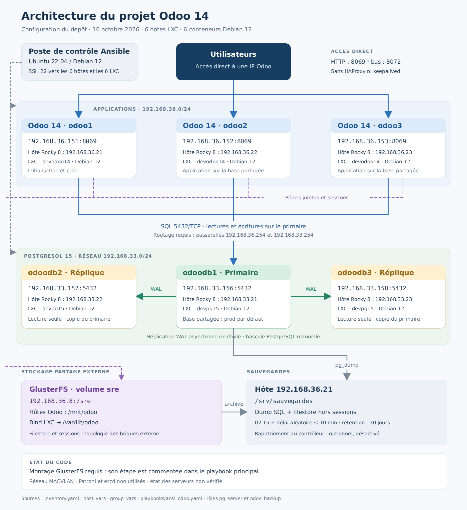

# Architecture actuelle du projet Odoo 14

Configuration du dépôt au **16 octobre 2026**, établie à partir de
[`inventory.yaml`](../inventory.yaml), des variables et des playbooks.
Ce document décrit la configuration prévue par le code ; il ne constitue
pas une vérification de l'état des serveurs.

[Diagramme vectoriel SVG](architecture-actuelle.svg) ·
[Source Mermaid modifiable](architecture-actuelle.mmd)

Trois applications Odoo 14 utilisent la même base PostgreSQL et le même
stockage de fichiers. Les utilisateurs choisissent directement une adresse
Odoo. Le primaire PostgreSQL alimente deux répliques en streaming WAL
asynchrone, chacune sur un hôte LXC distinct.

| Service | Adresse du conteneur | Hôte LXC Rocky 8 | Nom LXC local |
| --- | --- | --- | --- |
| `odoo1` — Odoo 14, initialisation et cron | `192.168.36.161` | `192.168.36.21` | `devodoo14` |
| `odoo2` — Odoo 14 | `192.168.36.162` | `192.168.36.22` | `devodoo14` |
| `odoo3` — Odoo 14 | `192.168.36.163` | `192.168.36.23` | `devodoo14` |
| `odoodb1` — PostgreSQL 15 primaire | `192.168.33.161` | `192.168.33.21` | `devpg15` |
| `odoodb2` — PostgreSQL 15 réplique | `192.168.33.162` | `192.168.33.22` | `devpg15` |
| `odoodb3` — PostgreSQL 15 réplique | `192.168.33.163` | `192.168.33.23` | `devpg15` |

Les conteneurs sont basés sur Debian 12. Un même nom LXC peut être réutilisé
sur des hôtes différents ; les alias Ansible et les adresses IP identifient
chaque instance.

## Circulation des données

1. Les utilisateurs accèdent à `http://192.168.36.161:8069`,
   `http://192.168.36.162:8069` ou `http://192.168.36.163:8069`.
   Le bus Odoo utilise le port `8072` avec les workers configurés.
2. Les trois Odoo se connectent à `192.168.33.161:5432`, avec le compte
   SQL `odoo`, sur la base `prod` par défaut. Le nom de base est
   surchargeable par `PROSYS_ODOO_DB`.
3. `odoodb1` réplique directement ses WAL vers `odoodb2` et `odoodb3`.
   Les répliques ne se répliquent pas l'une vers l'autre. Elles sont en
   lecture seule et disposent chacune d'un slot physique sur le primaire.
4. Le volume GlusterFS externe `192.168.36.8:/sre` fournit les fichiers
   partagés. Le montage prévu est `/mnt/odoo` sur les hôtes Odoo, transmis
   par bind LXC à `/var/lib/odoo` dans les conteneurs. Il couvre le
   filestore et les sessions puisque le répertoire de données entier est
   partagé. Le dépôt ne décrit pas les serveurs de briques du volume externe.
5. L'hôte `192.168.36.21` sauvegarde la base avec `pg_dump`, puis archive
   le filestore depuis `/mnt/odoo`, en excluant les sessions. Les fichiers
   sont conservés dans `/srv/sauvegardes`, avec une rétention de 30 jours.
   Le timer est prévu à 02:15, avec un délai aléatoire maximal de 10 minutes.
   Le rapatriement vers le contrôleur est optionnel et désactivé par défaut.

## Réseau et administration

Le poste de contrôle Ubuntu 22.04 ou Debian 12 utilise SSH (`22/TCP`) pour
administrer les six hôtes et leurs conteneurs directement.

| Usage | Réseau | Carte de l'hôte | Passerelle des conteneurs |
| --- | --- | --- | --- |
| Applications Odoo | `192.168.36.0/24` | `enp5s0` | `192.168.36.254` |
| PostgreSQL | `192.168.33.0/24` | `enp1s0` | `192.168.33.254` |

L'inventaire sélectionne **MACVLAN**, avec le mode `bridge` par défaut.
Chaque hôte conserve sa carte réseau. Le contrôleur doit pouvoir joindre
les IP des conteneurs, car un hôte ne peut pas joindre directement son
propre conteneur par cette interface MACVLAN.

Le routage entre les deux sous-réseaux et l'autorisation de `5432/TCP`
entre Odoo et PostgreSQL sont des prérequis externes au projet.

## Déploiement et bascule

[`ansi2-snapchot.yaml`](../playbooks/ansi2-snapchot.yaml) crée les LXC.
[`ansi_odoo.yaml`](../playbooks/ansi_odoo.yaml) prépare l'horloge et le
réseau, configure le primaire PostgreSQL puis les deux répliques, installe
Odoo, initialise la base uniquement depuis `odoo1`, puis démarre les trois
applications. [`ansi_sauvegarde.yaml`](../playbooks/ansi_sauvegarde.yaml)
installe et lance les sauvegardes.

**Le montage GlusterFS reste un prérequis :** la play `1bis/5` qui appelle
`odoo_filestore` est commentée dans le déploiement principal, tandis que le
rôle Odoo exige ce montage. Le rôle de montage existe et reste notamment
appelé par [`ansi_syncro.yaml`](../playbooks/ansi_syncro.yaml).

Le parcours actuel n'utilise **ni HAProxy, ni keepalived, ni Patroni, ni
etcd**. La panne du primaire PostgreSQL nécessite une **bascule manuelle** :
isoler l'ancien primaire, promouvoir une réplique, puis adapter les cibles
PostgreSQL dans l'inventaire et `odoo_db_host`, ainsi que la configuration
des applications, des sauvegardes et de la réplication restante. L'ancien
primaire doit être réintégré comme réplique avant de reprendre du service.

## Sources de la configuration

- [`inventory.yaml`](../inventory.yaml) : hôtes, conteneurs et groupes.
- [`host_vars/`](../host_vars/) : noms LXC, cartes, IP et passerelles.
- [`group_vars/all/vars.yml`](../group_vars/all/vars.yml) : cible SQL,
  ports, base partagée et volume GlusterFS.
- [`roles/pg_server/`](../roles/pg_server/) : primaire et réplication.
- [`roles/odoo_filestore/`](../roles/odoo_filestore/) : montage et bind LXC.
- [`roles/odoo_backup/`](../roles/odoo_backup/) : sauvegardes et timer.
