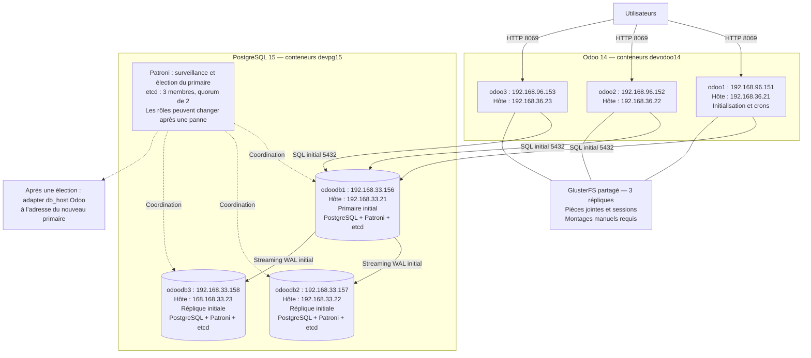

# Architecture du projet Odoo 14 sur LXC

Le dépôt déclare **six hôtes LXC**, trois conteneurs Odoo et trois
conteneurs PostgreSQL 15. **Patroni et etcd surveillent PostgreSQL et
permettent l’élection automatique d’un nouveau primaire.** Le diagramme
montre l’état initial prévu, avec `odoodb1` primaire ; ce rôle peut ensuite
passer à `odoodb2` ou `odoodb3`.
Cette configuration du dépôt ne confirme pas un déploiement sur les serveurs.

## Vue d’ensemble

Source Mermaid autonome : [`architecture-postgresql.mmd`](architecture-postgresql.mmd).

Les utilisateurs accèdent directement à `http://192.168.96.151:8069`,
`http://192.168.96.152:8069` ou `http://192.168.96.153:8069`.
Au départ, les trois Odoo utilisent `192.168.33.156:5432`.
Après une promotion par Patroni, **l’adresse configurée dans Odoo ne change
pas automatiquement**. Il faut renseigner le nouveau primaire dans
`odoo_db_host`, puis appliquer la configuration des trois instances avec
[`ansi_odoo_dbhost.yaml`](../playbooks/ansi_odoo_dbhost.yaml).
La découverte automatique du primaire par les applications pourra être
ajoutée séparément.

## Correspondance entre hôtes et conteneurs

`lxc_host` désigne l’hôte qui porte le conteneur. `ansible_host` désigne
l’adresse SSH du conteneur.

| Service initial | Alias Ansible | Nom LXC | Hôte LXC (`lxc_host`) | IP du conteneur (`ansible_host`) |
| --- | --- | --- | --- | --- |
| Odoo, initialisation et crons | `odoo1` | `devodoo14` | `192.168.36.21` | `192.168.96.151` |
| Odoo | `odoo2` | `devodoo14` | `192.168.36.22` | `192.168.96.152` |
| Odoo | `odoo3` | `devodoo14` | `192.168.36.23` | `192.168.96.153` |
| PostgreSQL primaire initial | `odoodb1` | `devpg15` | `192.168.33.21` | `192.168.33.156` |
| PostgreSQL réplique initiale | `odoodb2` | `devpg15` | `192.168.33.22` | `192.168.33.157` |
| PostgreSQL réplique initiale | `odoodb3` | `devpg15` | `168.168.33.23` | `192.168.33.158` |

Chaque conteneur PostgreSQL héberge aussi un membre etcd et un processus
Patroni. Le quorum etcd nécessite deux membres joignables sur trois.
Les groupes d’inventaire `db_primary` et `db_replicas` décrivent le placement
initial ; le primaire courant se vérifie auprès de Patroni.
Le groupe applicatif `odoo_primary` sélectionne `odoo1` pour l’initialisation
du registre et les crons Odoo.

## Réseau

| Flux | Port TCP | Usage |
| --- | --- | --- |
| Utilisateurs → Odoo | `8069` | Interface HTTP |
| Odoo → primaire PostgreSQL | `5432` | Lectures et écritures SQL |
| Répliques → primaire PostgreSQL | `5432` | Réplication physique WAL |
| Patroni → etcd | `2379` | Coordination et verrou du primaire |
| Membres etcd entre eux | `2380` | Consensus du cluster etcd |
| Patroni et administration | `8008` | API REST et état des membres |
| Poste Ansible → hôtes et conteneurs | `22` | Administration SSH |

La création utilise Debian 12 `bookworm`. Le rôle réseau attribue une carte
physique dédiée au conteneur (`lxc.net.0.type = phys`, interface interne
`eth0`). L’inventaire fixe `nic=ens224`, surchargeable dans `host_vars`.
Les `host_vars` des hôtes PostgreSQL définissent `ct_ip`. Adapter aussi
`ct_prefix`, `ct_gateway` et `ct_dns_servers` au LAN réel. La passerelle doit
appartenir au réseau du conteneur. L’adresse de l’hôte `168.168.33.23`
est conservée, alors que son conteneur est sur `192.168.33.158`.

## Déploiement et exploitation

La création LXC passe par [`ansi2-snapchot.yaml`](../playbooks/ansi2-snapchot.yaml).
Le déploiement principal [`ansi_odoo.yaml`](../playbooks/ansi_odoo.yaml)
prépare le réseau, déploie PostgreSQL avec Patroni et etcd, puis configure
et initialise Odoo avant de démarrer les instances.
Voir [`POSTGRESQL-PATRONI.md`](POSTGRESQL-PATRONI.md) pour les secrets,
les commandes et le contrôle du primaire courant.

Le mode à primaire fixe avec `pg_replication` est une alternative décrite
dans [`POSTGRESQL-REPLICATION.md`](POSTGRESQL-REPLICATION.md), utilisable
uniquement lorsque `pg_ha_enabled: false`. Les deux modes ne doivent pas
piloter les mêmes instances simultanément.

Le changement d’adresse depuis l’ancien serveur `192.168.96.150` ne migre
pas automatiquement ses données. Une reprise de données existantes
nécessite une procédure adaptée avant la remise en service des écritures.

## Stockage et sauvegardes

- [`ansi_sauvegarde.yaml`](../playbooks/ansi_sauvegarde.yaml) configure les
  sauvegardes de la base et du filestore sur `192.168.36.21`. Après une
  bascule PostgreSQL, vérifier que la cible SQL des sauvegardes correspond
  au primaire courant.
- [`ansi_syncro.yaml`](../playbooks/ansi_syncro.yaml) prépare les pièces
  jointes et le stockage partagé. Le volume GlusterFS et ses montages
  restent des prérequis manuels. Le répertoire de données partagé attendu
  par Odoo est `/var/lib/odoo`.

La réplication PostgreSQL propage aussi les suppressions et les erreurs
applicatives. Conserver les sauvegardes de la base et des pièces jointes.
