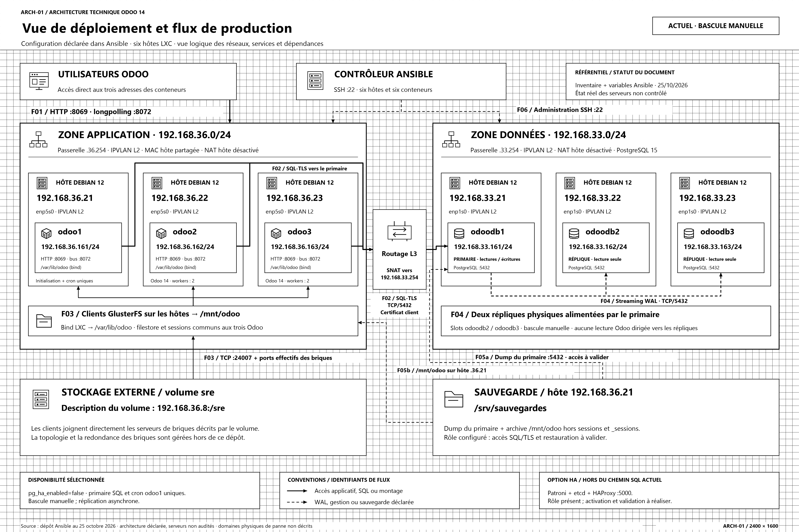
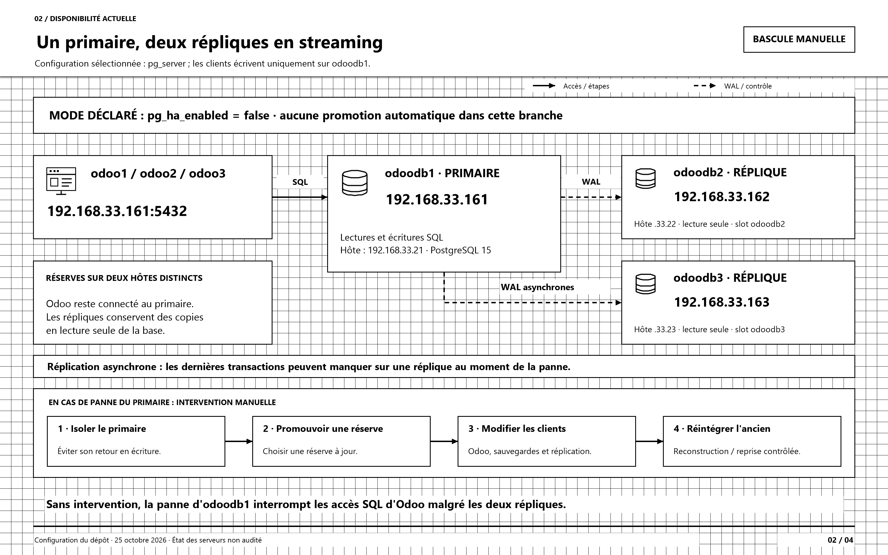
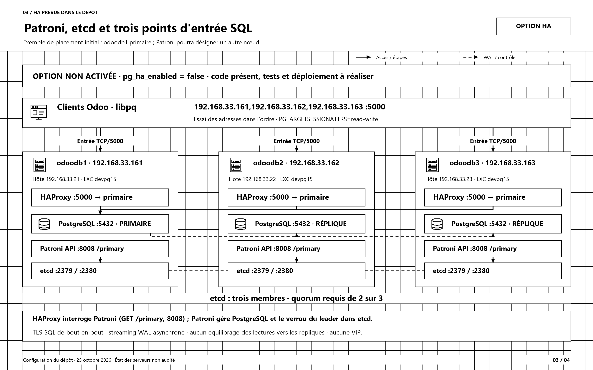
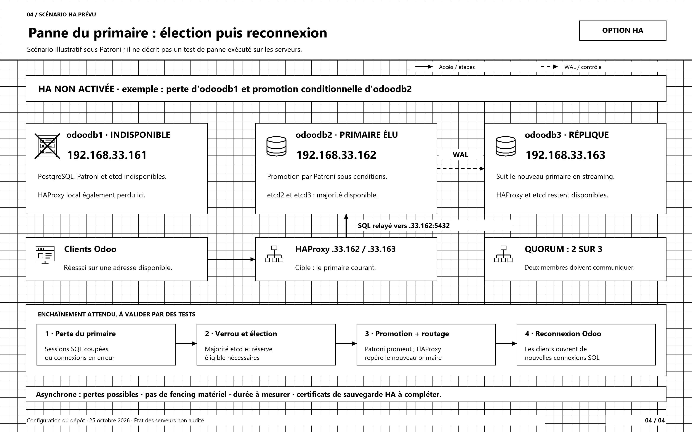

# Architecture actuelle et disponibilité PostgreSQL

Configuration du dépôt au **25 octobre 2026**. Les schémas représentent les fichiers Ansible, sans audit des serveurs.

**État déclaré : pg_ha_enabled=false.** Odoo vise odoodb1 en direct sur 5432. Le rôle Patroni/etcd/HAProxy existe comme option ; la documentation du projet le décrit au 23 octobre comme écrit, non testé et non déployé. Les vues 3 et 4 représentent cette option et un scénario illustratif, pas une HA constatée en exploitation.

La **vue de déploiement expert** est disponible seule dans [architecture-actuelle-expert.drawio](architecture-actuelle-expert.drawio), au format paysage 2400 × 1600. Les zones réseau, limites des hôtes et conteneurs, flux identifiés et dépendances sont explicités.

Ouvrir [architecture-actuelle-et-ha-postgresql.drawio](architecture-actuelle-et-ha-postgresql.drawio) dans draw.io / diagrams.net ou dans l'extension Draw.io de VS Code. Les quatre onglets sont modifiables : noir et blanc, grille visible de 20 unités, icônes vectorielles.

| Vue | Aperçu PNG | Version SVG |
| --- | --- | --- |
| Architecture technique expert · 2400 × 1600 | [PNG](01-architecture-actuelle.png) | [SVG](01-architecture-actuelle.svg) |
| Réplication et bascule manuelle | [PNG](02-replication-et-bascule-manuelle.png) | [SVG](02-replication-et-bascule-manuelle.svg) |
| Option HA Patroni / etcd / HAProxy | [PNG](03-option-ha-patroni-etcd-haproxy.png) | [SVG](03-option-ha-patroni-etcd-haproxy.svg) |
| Bascule HA et quorum | [PNG](04-bascule-ha-et-quorum.png) | [SVG](04-bascule-ha-et-quorum.svg) |

## Lecture de la vue expert

Les flèches portent un identifiant stable. Les traits pleins décrivent les accès applicatifs, SQL et stockage ; les pointillés décrivent la réplication, la gestion ou les sauvegardes déclarées.

| Flux | Source → destination | Protocole / usage |
| --- | --- | --- |
| F01 | Utilisateurs → conteneurs Odoo | TCP/8069, TCP/8072 pour le bus |
| F02 | Odoo → routeur externe → odoodb1 | SQL TCP/5432, TLS verify-full et certificat client ; SNAT externe .33.254 |
| F03 | Clients GlusterFS des hôtes → serveurs externes | Description du volume via .36.8:24007, puis ports effectifs des briques ; montage /mnt/odoo et bind vers /var/lib/odoo |
| F04 | odoodb1 → odoodb2 et odoodb3 | Réplication physique WAL asynchrone, TCP/5432 |
| F05a | Sauvegarde sur .36.21 → primaire | pg_dump TCP/5432 ; accès SQL/TLS à valider |
| F05b | Sauvegarde sur .36.21 → montage local | Lecture de /mnt/odoo sur le même hôte, hors sessions et _sessions |
| F06 | Contrôleur Ansible → hôtes et conteneurs | Administration SSH TCP/22 |

Les flèches de montage F03 illustrent la dépendance au volume. Les clients GlusterFS résident sur les hôtes, et les conteneurs reçoivent un bind du montage. Le bloc de montage est une représentation groupée des trois clients, pas un équipement supplémentaire.

Les hôtes LXC sont distincts dans l'inventaire. Leur placement physique et leurs domaines de panne ne sont pas décrits. La topologie et la redondance des briques GlusterFS restent externes au dépôt. La sauvegarde est configurée ; son accès SQL/TLS et une restauration doivent être validés avant de la considérer opérationnelle.

## Architecture déclarée

| Service | Conteneur | Hôte LXC |
| --- | --- | --- |
| Odoo 1, initialisation et cron | 192.168.36.161 | 192.168.36.21 |
| Odoo 2 | 192.168.36.162 | 192.168.36.22 |
| Odoo 3 | 192.168.36.163 | 192.168.36.23 |
| PostgreSQL primaire odoodb1 | 192.168.33.161 | 192.168.33.21 |
| Réplique odoodb2 | 192.168.33.162 | 192.168.33.22 |
| Réplique odoodb3 | 192.168.33.163 | 192.168.33.23 |

Les interfaces LXC utilisent IPVLAN L2, sans NAT sur les hôtes. Le routeur externe effectue en revanche un SNAT vers 192.168.33.254 selon la configuration récente du dépôt. Pour les connexions Odoo, PostgreSQL exige un certificat client et le client vérifie le serveur en TLS.

Les trois hôtes Odoo montent le volume GlusterFS externe sre sur /mnt/odoo et le présentent aux conteneurs sur /var/lib/odoo. 192.168.36.8 fournit la description du volume ; les clients communiquent ensuite directement avec les serveurs de briques. Le détail de ces serveurs reste externe au dépôt.

Les utilisateurs accèdent directement aux Odoo sur 8069 ; le bus utilise 8072. Aucun répartiteur HTTP ou VIP applicative n'est représenté. La sauvegarde est déclarée sur .36.21 dans /srv/sauvegardes, avec dump SQL et archive du volume hors sessions.

## Disponibilité actuelle et option HA

| Point | Branche actuelle | Option Patroni |
| --- | --- | --- |
| Sélection | pg_ha_enabled=false | Activation après reprise et validation |
| Connexion Odoo | .33.161:5432 | .33.161,.33.162,.33.163:5000 via libpq |
| Gestion du primaire | Rôle pg_server, placement fixe | Patroni et verrou dans etcd |
| Panne du primaire | Intervention manuelle | Promotion automatique sous conditions |
| Réplication | Streaming asynchrone, deux slots | Streaming asynchrone géré par Patroni |
| Routage SQL | Adresse directe du primaire | Trois HAProxy dirigés vers le primaire courant |

En HA, chaque conteneur PostgreSQL porte PostgreSQL, Patroni, etcd et HAProxy. Les trois HAProxy ne répartissent pas les lectures entre les répliques. Ils utilisent GET /primary sur l'API Patroni pour sélectionner le primaire détenteur du verrou. [API Patroni](https://patroni.readthedocs.io/en/latest/rest_api.html)

| Port HA | Flux |
| --- | --- |
| 5000/TCP | Clients Odoo vers les trois HAProxy |
| 5432/TCP | HAProxy vers PostgreSQL et streaming entre serveurs |
| 8008/HTTP | Contrôles et API Patroni |
| 2379/HTTPS | Patroni vers etcd |
| 2380/HTTPS | Consensus entre membres etcd |
| 7000/HTTP | Statistiques HAProxy sur 127.0.0.1 uniquement |

Le TLS PostgreSQL traverse HAProxy sans terminaison. Les certificats SQL couvrent les trois adresses. Etcd utilise une autorité de certification distincte ; l'API Patroni reste en HTTP.

## Conditions et limites représentées

- La majorité etcd exige **2 membres sur 3**. Une réserve doit être éligible pour devenir primaire ; sans majorité, aucune bascule automatique sûre ne peut être décidée.
- Le scénario de la page 4 choisit odoodb2 comme exemple. Ce n'est ni une préférence imposée ni le résultat d'un test.
- La réplication reste asynchrone : des transactions récentes peuvent être perdues. maximum_lag_on_failover=1048576 est un seuil d'éligibilité, **pas une garantie de perte maximale de 1 Mio**. [Modes de réplication Patroni](https://patroni.readthedocs.io/en/latest/replication_modes.html)
- Les réglages sont ttl=30 s, loop_wait=10 s et contrôles HAProxy toutes les 3 s. Le temps réel de rétablissement n'a pas été mesuré ; les requêtes et transactions en cours peuvent échouer.
- watchdog.mode=off : aucun fencing matériel n'est configuré. La relance systemd de Patroni ne couvre pas tous les blocages. [Protection du primaire](https://patroni.readthedocs.io/en/latest/watchdog.html)
- Le rôle sauvegarde prépare les endpoints HA mais ne déploie pas le certificat client ni l'environnement TLS exigés pour pg_dump via HAProxy. Cette partie reste à compléter et valider.
- Après une promotion, db_containers et db_replicas décrivent le placement initial ; les scripts qui s'appuient sur ces groupes doivent être réexaminés. L'ancien primaire doit être réintégré sous contrôle ; pg_rewind nécessite ses préconditions.
- La HA SQL ne rend pas automatiquement disponibles le cron porté par odoo1, les accès web, GlusterFS ou l'infrastructure physique.

## Sources du projet

- [Inventaire](../../inventory.yaml) et [variables communes](../../group_vars/all/vars.yml).
- [Playbook Odoo](../../playbooks/ansi_odoo.yaml).
- [Rôle PostgreSQL actuel](../../roles/ansi_odoo/pg_server/tasks/main.yaml), [réplication](../../roles/ansi_odoo/pg_server/templates/20-replication.conf.j2).
- [Playbook HA](../../playbooks/ansi_postgresql_ha.yaml), [paramètres Patroni / etcd](../../roles/ansi_postgresql_ha/pg_ha/defaults/main.yml), [HAProxy](../../roles/ansi_postgresql_ha/pg_ha/templates/haproxy.cfg.j2).
- [Documentation HA du projet](../POSTGRESQL-PATRONI.md).
- [Montage GlusterFS](../../roles/ansi_odoo/odoo_filestore/tasks/main.yaml), [variables sauvegarde](../../group_vars/backup_host/vars.yml), [rôle sauvegarde](../../roles/ansi_sauvegarde/odoo_backup/tasks/main.yaml).

## Régénération

Depuis PowerShell sous Windows : .\generer-schemas.ps1

Le générateur autonome utilise XML, SVG et System.Drawing. Il produit le document à quatre pages, la vue expert autonome, les SVG et les PNG (4800 × 3200 pour la vue expert, 3200 × 2000 pour les trois vues de disponibilité), et vérifie le texte et les limites de page. Les changements effectués dans draw.io ne sont pas réimportés dans le générateur.
