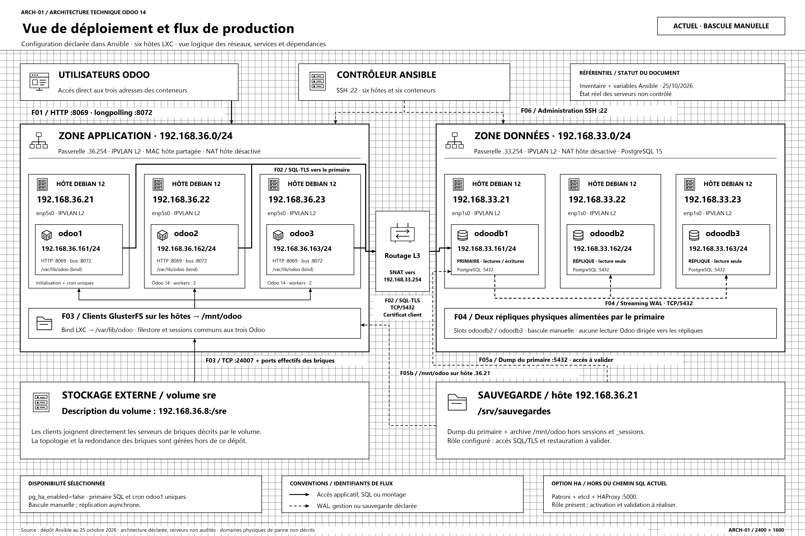
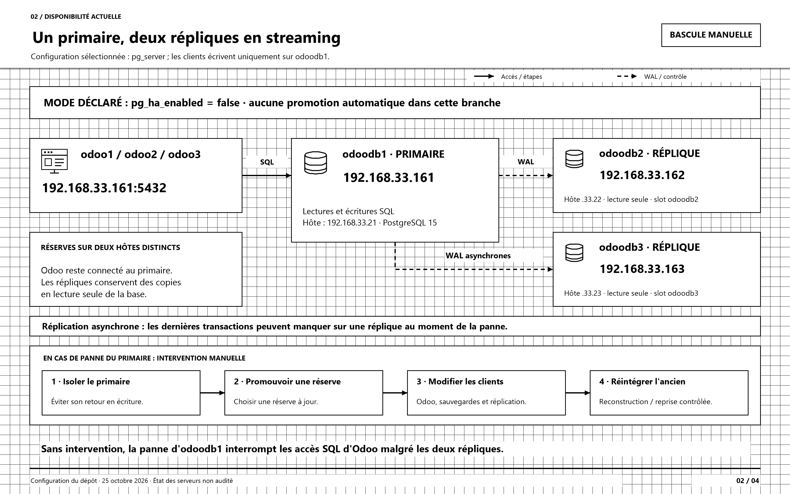
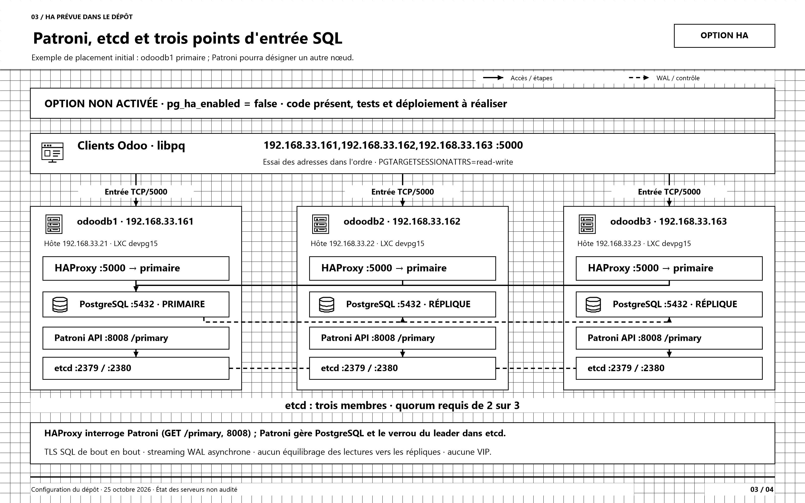
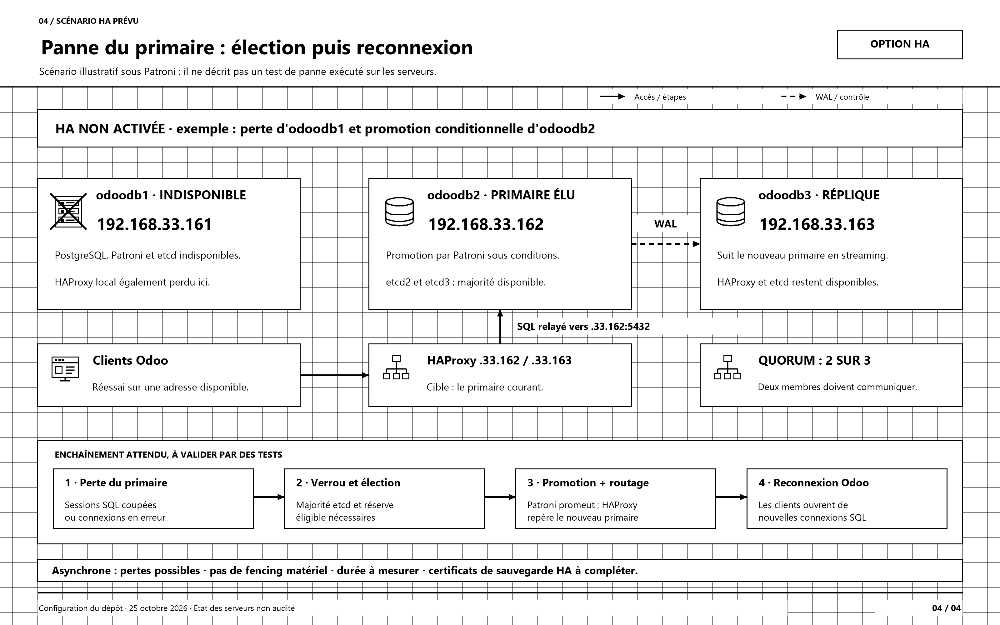

# Architecture actuelle et disponibilité PostgreSQL

Configuration du dépôt au **25 octobre 2026**. Les schémas représentent les fichiers Ansible, sans audit des serveurs.

**État déclaré : pg_ha_enabled=false.** Odoo vise odoodb1 en direct sur 5432. Le rôle Patroni/etcd/HAProxy existe comme option ; la documentation du projet le décrit au 23 octobre comme écrit, non testé et non déployé. Les vues 3 et 4 représentent cette option et un scénario illustratif, pas une HA constatée en exploitation.

La **vue de déploiement expert** est disponible seule dans [architecture-actuelle-expert.drawio](architecture-actuelle-expert.drawio), au format paysage 2400 × 1600. Les zones réseau, limites des hôtes et conteneurs, flux identifiés et dépendances sont explicités.

Ouvrir [architecture-actuelle-et-ha-postgresql.drawio](architecture-actuelle-et-ha-postgresql.drawio) dans draw.io / diagrams.net ou dans l'extension Draw.io de VS Code. Les quatre onglets sont modifiables : noir et blanc, grille visible de 20 unités, icônes vectorielles.

| Vue | Aperçu PNG | Version SVG |
| --- | --- | --- |
| Architecture technique expert · 2400 × 1600 | [PNG](01-architecture-actuelle.png) | [SVG](01-architecture-actuelle.svg) |
| Réplication et bascule manuelle | [PNG](02-replication-et-bascule-manuelle.png) | [SVG](02-replication-et-bascule-manuelle.svg) |
| Option HA Patroni / etcd / HAProxy | [PNG](03-option-ha-patroni-etcd-haproxy.png) | [SVG](03-option-ha-patroni-etcd-haproxy.svg) |
| Bascule HA et quorum | [PNG](04-bascule-ha-et-quorum.png) | [SVG](04-bascule-ha-et-quorum.svg) |

## Explication de chaque schéma

**Contexte historique :** les quatre vues décrivent l’édition du 25 octobre 2026, où `pg_ha_enabled=false`. Dans les variables de la série du 3 novembre 2026, ce paramètre vaut `true`. Les expressions « actuelle » et « option HA » ci-dessous se rapportent donc à l’ancienne édition. Consulter la [série Patroni et Odoo 14](../schemas-patroni-odoo14/README.md) pour la configuration récente.

### 01 — Architecture technique expert

[Ouvrir le schéma](01-architecture-actuelle.svg).

**Objectif :** situer les applications, les bases, le stockage et l’administration dans une vue d’ensemble.

Les contours séparent les réseaux, les hôtes et leurs conteneurs. Trois Odoo utilisent un primaire PostgreSQL fixe, odoodb1, qui réplique ses WAL vers odoodb2 et odoodb3. Le volume GlusterFS externe fournit les fichiers partagés. L’hôte de sauvegarde produit le dump SQL et l’archive des fichiers.

**Parcours à suivre :** utilisateur → Odoo sur `8069` → routeur externe → odoodb1 sur `5432`. Suivre ensuite les liens vers GlusterFS pour les fichiers, les WAL vers les répliques et les flux de sauvegarde. Les identifiants F01 à F06 sont détaillés dans la table de lecture ci-dessous.

**À retenir :** les trois Odoo partagent les données ; cette architecture diffère de trois instances autonomes. Le dessin historique emploie un montage GlusterFS sur l’hôte puis un bind LXC. La présence de plusieurs nœuds ne prouve pas à elle seule l’indépendance de leurs domaines de panne physiques.

### 02 — Réplication et bascule manuelle

[Ouvrir le schéma](02-replication-et-bascule-manuelle.svg).

**Objectif :** comprendre ce que la réplication apporte avant l’automatisation de la bascule.

Odoodb1 accepte les écritures et transmet ses WAL aux deux répliques. Celles-ci les rejouent pour suivre la base primaire. La réplication est asynchrone : elles peuvent présenter un retard.

**Parcours à suivre :** écritures sur le primaire → émission des WAL → réception et rejeu sur les répliques. En cas de panne, une intervention doit sélectionner une réplique, la promouvoir et adapter les accès applicatifs. L’ancien primaire doit être maîtrisé pour éviter qu’il reprenne des écritures indépendantes.

**À retenir :** la réplication maintient des copies mais ne redirige pas automatiquement Odoo. Des transactions récentes peuvent manquer sur la réplique promue. Le filestore et le cron applicatif doivent être considérés séparément du rôle PostgreSQL.

### 03 — Option HA Patroni / etcd / HAProxy

[Ouvrir le schéma](03-option-ha-patroni-etcd-haproxy.svg).

**Objectif :** expliquer les composants ajoutés pour coordonner les rôles et acheminer le SQL vers le primaire courant.

Chaque nœud de données héberge PostgreSQL, un agent Patroni, un membre etcd et HAProxy. Patroni pilote son PostgreSQL local. Etcd conserve les informations de coordination et le verrou du leader. Chaque HAProxy interroge les API Patroni pour identifier le primaire.

**Parcours à suivre :** Odoo → un des trois endpoints HAProxy sur `5000` → primaire PostgreSQL sur `5432`. Suivre séparément HAProxy → API Patroni sur `8008`, Patroni → etcd sur `2379` et les échanges etcd sur `2380`.

**À retenir :** HAProxy dirige le SQL vers le primaire ; il ne répartit pas les lectures entre les répliques dans cette configuration. Le TLS PostgreSQL le traverse jusqu’au serveur SQL. Les WAL passent directement entre PostgreSQL, sans traverser Patroni ou etcd. Cette vue était une option à sa date de création.

### 04 — Bascule HA et quorum

[Ouvrir le schéma](04-bascule-ha-et-quorum.svg).

**Objectif :** suivre le changement de primaire après une panne et comprendre le rôle de la majorité etcd.

Le scénario illustre la perte du primaire puis la promotion d’une réplique éligible sous le contrôle de Patroni. Avec trois membres etcd, deux membres doivent pouvoir former la majorité pour la coordination. HAProxy détecte ensuite le nouveau primaire et adapte la destination des nouvelles connexions.

**Parcours à suivre :** panne → coordination avec quorum → promotion d’une réplique → détection par HAProxy → reconnexion applicative. Odoodb2 est choisi pour illustrer le scénario ; il ne s’agit pas d’une préférence imposée ni d’un résultat observé.

**À retenir :** la majorité etcd concerne la coordination, pas la réception des WAL. Elle ne garantit pas zéro perte de transactions avec une réplication asynchrone. Les sessions interrompues doivent se reconnecter et les transactions en cours ne sont pas transférées. Le watchdog est désactivé dans les LXC ; cette vue ne représente pas un fencing matériel. La HA SQL ne déplace pas automatiquement le cron Odoo et ne garantit pas la disponibilité web ou GlusterFS.

### Comparer les quatre vues

| Vue | Question traitée | Ce qu’elle permet de comprendre |
| --- | --- | --- |
| 01 | Où sont les composants et les flux ? | Placement et dépendances de l’ancienne architecture. |
| 02 | Comment les copies SQL suivent-elles le primaire ? | Réplication et reprise nécessitant une intervention. |
| 03 | Quels composants automatisent la gestion des rôles ? | Répartition des responsabilités entre PostgreSQL, Patroni, etcd et HAProxy. |
| 04 | Que se passe-t-il lors d’une panne ? | Enchaînement de la bascule et conditions de quorum. |

[Revenir au guide général des schémas](../README.md).

## Lecture de la vue expert

Les flèches portent un identifiant stable. Les traits pleins décrivent les accès applicatifs, SQL et stockage ; les pointillés décrivent la réplication, la gestion ou les sauvegardes déclarées.

| Flux | Source → destination | Protocole / usage |
| --- | --- | --- |
| F01 | Utilisateurs → conteneurs Odoo | TCP/8069, TCP/8072 pour le bus |
| F02 | Odoo → routeur externe → odoodb1 | SQL TCP/5432, TLS verify-full et certificat client ; SNAT externe .33.254 |
| F03 | Clients GlusterFS des hôtes → serveurs externes | Description du volume via .36.8:24007, puis ports effectifs des briques ; montage /mnt/odoo et bind vers /var/lib/odoo |
| F04 | odoodb1 → odoodb2 et odoodb3 | Réplication physique WAL asynchrone, TCP/5432 |
| F05a | Sauvegarde sur .36.21 → primaire | pg_dump TCP/5432 ; accès SQL/TLS à valider |
| F05b | Sauvegarde sur .36.21 → montage local | Lecture de /mnt/odoo sur le même hôte, hors sessions et _sessions |
| F06 | Contrôleur Ansible → hôtes et conteneurs | Administration SSH TCP/22 |

Les flèches de montage F03 illustrent la dépendance au volume. Les clients GlusterFS résident sur les hôtes, et les conteneurs reçoivent un bind du montage. Le bloc de montage est une représentation groupée des trois clients, pas un équipement supplémentaire.

Les hôtes LXC sont distincts dans l'inventaire. Leur placement physique et leurs domaines de panne ne sont pas décrits. La topologie et la redondance des briques GlusterFS restent externes au dépôt. La sauvegarde est configurée ; son accès SQL/TLS et une restauration doivent être validés avant de la considérer opérationnelle.

## Architecture déclarée

| Service | Conteneur | Hôte LXC |
| --- | --- | --- |
| Odoo 1, initialisation et cron | 192.168.36.161 | 192.168.36.21 |
| Odoo 2 | 192.168.36.162 | 192.168.36.22 |
| Odoo 3 | 192.168.36.163 | 192.168.36.23 |
| PostgreSQL primaire odoodb1 | 192.168.33.161 | 192.168.33.21 |
| Réplique odoodb2 | 192.168.33.162 | 192.168.33.22 |
| Réplique odoodb3 | 192.168.33.163 | 192.168.33.23 |

Les interfaces LXC utilisent IPVLAN L2, sans NAT sur les hôtes. Le routeur externe effectue en revanche un SNAT vers 192.168.33.254 selon la configuration récente du dépôt. Pour les connexions Odoo, PostgreSQL exige un certificat client et le client vérifie le serveur en TLS.

Les trois hôtes Odoo montent le volume GlusterFS externe sre sur /mnt/odoo et le présentent aux conteneurs sur /var/lib/odoo. 192.168.36.8 fournit la description du volume ; les clients communiquent ensuite directement avec les serveurs de briques. Le détail de ces serveurs reste externe au dépôt.

Les utilisateurs accèdent directement aux Odoo sur 8069 ; le bus utilise 8072. Aucun répartiteur HTTP ou VIP applicative n'est représenté. La sauvegarde est déclarée sur .36.21 dans /srv/sauvegardes, avec dump SQL et archive du volume hors sessions.

## Disponibilité actuelle et option HA

| Point | Branche actuelle | Option Patroni |
| --- | --- | --- |
| Sélection | pg_ha_enabled=false | Activation après reprise et validation |
| Connexion Odoo | .33.161:5432 | .33.161,.33.162,.33.163:5000 via libpq |
| Gestion du primaire | Rôle pg_server, placement fixe | Patroni et verrou dans etcd |
| Panne du primaire | Intervention manuelle | Promotion automatique sous conditions |
| Réplication | Streaming asynchrone, deux slots | Streaming asynchrone géré par Patroni |
| Routage SQL | Adresse directe du primaire | Trois HAProxy dirigés vers le primaire courant |

En HA, chaque conteneur PostgreSQL porte PostgreSQL, Patroni, etcd et HAProxy. Les trois HAProxy ne répartissent pas les lectures entre les répliques. Ils utilisent GET /primary sur l'API Patroni pour sélectionner le primaire détenteur du verrou. [API Patroni](https://patroni.readthedocs.io/en/latest/rest_api.html)

| Port HA | Flux |
| --- | --- |
| 5000/TCP | Clients Odoo vers les trois HAProxy |
| 5432/TCP | HAProxy vers PostgreSQL et streaming entre serveurs |
| 8008/HTTP | Contrôles et API Patroni |
| 2379/HTTPS | Patroni vers etcd |
| 2380/HTTPS | Consensus entre membres etcd |
| 7000/HTTP | Statistiques HAProxy sur 127.0.0.1 uniquement |

Le TLS PostgreSQL traverse HAProxy sans terminaison. Les certificats SQL couvrent les trois adresses. Etcd utilise une autorité de certification distincte ; l'API Patroni reste en HTTP.

## Conditions et limites représentées

- La majorité etcd exige **2 membres sur 3**. Une réserve doit être éligible pour devenir primaire ; sans majorité, aucune bascule automatique sûre ne peut être décidée.
- Le scénario de la page 4 choisit odoodb2 comme exemple. Ce n'est ni une préférence imposée ni le résultat d'un test.
- La réplication reste asynchrone : des transactions récentes peuvent être perdues. maximum_lag_on_failover=1048576 est un seuil d'éligibilité, **pas une garantie de perte maximale de 1 Mio**. [Modes de réplication Patroni](https://patroni.readthedocs.io/en/latest/replication_modes.html)
- Les réglages sont ttl=30 s, loop_wait=10 s et contrôles HAProxy toutes les 3 s. Le temps réel de rétablissement n'a pas été mesuré ; les requêtes et transactions en cours peuvent échouer.
- watchdog.mode=off : aucun fencing matériel n'est configuré. La relance systemd de Patroni ne couvre pas tous les blocages. [Protection du primaire](https://patroni.readthedocs.io/en/latest/watchdog.html)
- Le rôle sauvegarde prépare les endpoints HA mais ne déploie pas le certificat client ni l'environnement TLS exigés pour pg_dump via HAProxy. Cette partie reste à compléter et valider.
- Après une promotion, db_containers et db_replicas décrivent le placement initial ; les scripts qui s'appuient sur ces groupes doivent être réexaminés. L'ancien primaire doit être réintégré sous contrôle ; pg_rewind nécessite ses préconditions.
- La HA SQL ne rend pas automatiquement disponibles le cron porté par odoo1, les accès web, GlusterFS ou l'infrastructure physique.

## Sources du projet

- [Inventaire](../../inventory.yaml) et [variables communes](../../group_vars/all/vars.yml).
- [Playbook Odoo](../../playbooks/ansi_odoo.yaml).
- [Rôle PostgreSQL actuel](../../roles/ansi_odoo/pg_server/tasks/main.yaml), [réplication](../../roles/ansi_odoo/pg_server/templates/20-replication.conf.j2).
- [Playbook HA](../../playbooks/ansi_postgresql_ha.yaml), [paramètres Patroni / etcd](../../roles/ansi_postgresql_ha/pg_ha/defaults/main.yml), [HAProxy](../../roles/ansi_postgresql_ha/pg_ha/templates/haproxy.cfg.j2).
- [Documentation HA du projet](../POSTGRESQL-PATRONI.md).
- [Montage GlusterFS](../../roles/ansi_odoo/odoo_filestore/tasks/main.yaml), [variables sauvegarde](../../group_vars/backup_host/vars.yml), [rôle sauvegarde](../../roles/ansi_sauvegarde/odoo_backup/tasks/main.yaml).

## Régénération

Depuis PowerShell sous Windows : .\generer-schemas.ps1

Le générateur autonome utilise XML, SVG et System.Drawing. Il produit le document à quatre pages, la vue expert autonome, les SVG et les PNG (4800 × 3200 pour la vue expert, 3200 × 2000 pour les trois vues de disponibilité), et vérifie le texte et les limites de page. Les changements effectués dans draw.io ne sont pas réimportés dans le générateur.

