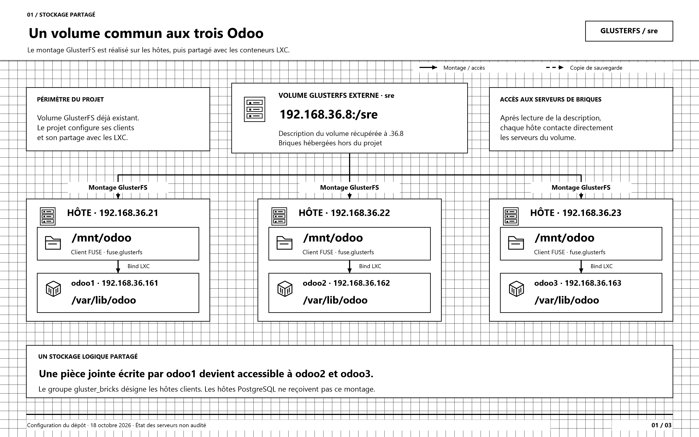
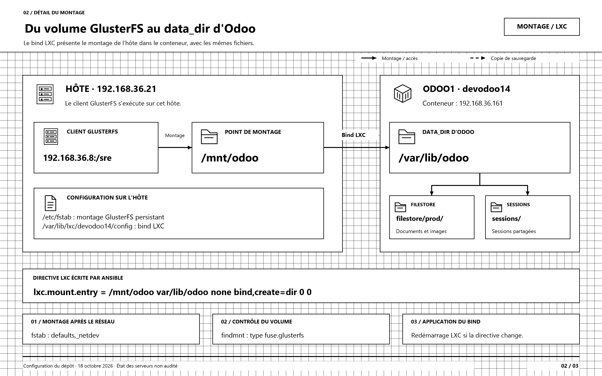
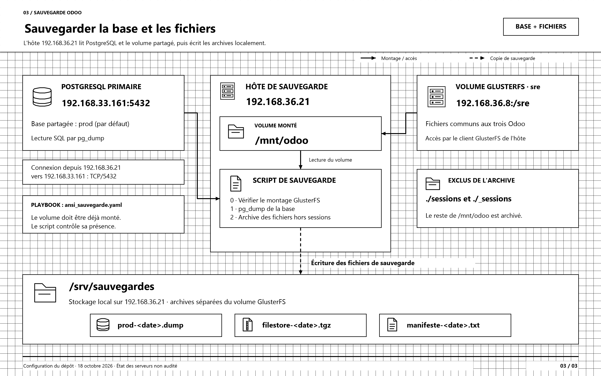

# Schémas GlusterFS du projet Odoo

Configuration du dépôt au 18 octobre 2026. Les schémas décrivent les montages prévus par Ansible ; ils ne vérifient pas l'état des serveurs.

Ouvrir [architecture-glusterfs-professionnelle.drawio](architecture-glusterfs-professionnelle.drawio) dans draw.io / diagrams.net ou dans l'extension Draw.io de VS Code. Le document contient trois onglets modifiables, en noir et blanc, avec icônes vectorielles et quadrillage visible de 20 unités.

| Vue | Aperçu PNG | Version SVG |
| --- | --- | --- |
| Volume partagé entre les trois Odoo | [PNG](01-volume-partage-trois-odoo.png) | [SVG](01-volume-partage-trois-odoo.svg) |
| Montage sur l'hôte et bind LXC | [PNG](02-montage-hote-et-bind-lxc.png) | [SVG](02-montage-hote-et-bind-lxc.svg) |
| GlusterFS et sauvegarde | [PNG](03-glusterfs-et-sauvegarde.png) | [SVG](03-glusterfs-et-sauvegarde.svg) |

## Explication de chaque schéma

**Contexte historique :** les vues du 18 octobre 2026 montrent un montage GlusterFS sur l’hôte suivi d’un bind dans le conteneur. Le playbook récent monte directement le volume dans chaque conteneur Odoo sur `/var/lib/odoo` ; l’hôte de sauvegarde conserve un montage en lecture seule sur `/mnt/odoo`. Voir la [série Patroni et Odoo 14](../schemas-patroni-odoo14/README.md).

### 01 — Volume partagé entre les trois Odoo

[Ouvrir le schéma](01-volume-partage-trois-odoo.svg).

**Objectif :** montrer comment les trois instances Odoo retrouvent les mêmes fichiers.

Les trois clients accèdent au volume externe `sre`, dont la description est obtenue auprès de `192.168.36.8`. Le répertoire de données Odoo expose notamment `filestore/prod`, pour les fichiers de la base `prod`, ainsi que les sessions. Le nom de base peut être surchargé dans la configuration.

**Parcours à suivre :** instance Odoo → répertoire de données → montage partagé → volume GlusterFS. Les clients communiquent avec les serveurs de briques annoncés par le volume ; le serveur qui fournit sa description n’est pas nécessairement l’unique serveur de données.

**À retenir :** le partage permet aux instances de retrouver les mêmes pièces jointes. Les données structurées restent dans PostgreSQL : GlusterFS et PostgreSQL remplissent deux fonctions complémentaires. Le détail de la redondance des briques reste externe au dépôt.

### 02 — Montage sur l’hôte et bind LXC

[Ouvrir le schéma](02-montage-hote-et-bind-lxc.svg).

**Objectif :** détailler les couches du montage utilisé dans cette ancienne édition.

Chaque hôte Odoo monte le volume sur `/mnt/odoo`. Un bind présente ensuite ce même répertoire dans son conteneur à l’emplacement `/var/lib/odoo`. Le processus Odoo utilise ce chemin comme répertoire de données.

**Parcours à suivre :** volume externe → client GlusterFS de l’hôte → `/mnt/odoo` → bind LXC → `/var/lib/odoo` → Odoo.

**À retenir :** le bind expose les mêmes fichiers dans un autre espace de montage ; il ne les copie pas. Le montage doit être présent avant que l’application utilise ses données. Les droits Unix doivent aussi permettre au compte Odoo de lire et d’écrire. Pour le montage direct dans les conteneurs de la configuration récente, utiliser la série de référence liée ci-dessus.

### 03 — GlusterFS et sauvegarde

[Ouvrir le schéma](03-glusterfs-et-sauvegarde.svg).

**Objectif :** distinguer les données partagées en service des archives de sauvegarde.

L’hôte `192.168.36.21` lit le montage `/mnt/odoo` pour archiver les fichiers. La sauvegarde associe cette archive à un dump PostgreSQL et écrit dans `/srv/sauvegardes`. Les répertoires `sessions` et `_sessions` sont exclus ; le rapatriement vers le contrôleur est facultatif et désactivé par défaut.

**Parcours à suivre :** PostgreSQL → dump SQL, puis montage GlusterFS → archive des fichiers → répertoire de sauvegarde. Les pointillés représentent l’écriture des archives.

**À retenir :** une restauration Odoo doit retrouver un ensemble cohérent de données SQL et de pièces jointes. Le partage ou la réplication du stockage ne remplace pas une sauvegarde : une suppression peut se répercuter sur les données partagées. L’accès SQL/TLS du processus de sauvegarde et une restauration restent à valider ; le dessin ne démontre pas leur réussite.

[Revenir au guide général des schémas](../README.md).

## Lire les schémas

- Trait plein : montage ou accès logique aux données.
- Trait pointillé : écriture des fichiers de sauvegarde.
- La grille apparaît dans le document draw.io et dans les exports ; ses lignes sont verrouillées.
- Les icônes, textes et connecteurs sont des éléments vectoriels modifiables.
- Le volume sre est externe au projet. Le serveur 192.168.36.8 fournit sa description ; les clients joignent ensuite directement les serveurs de briques indiqués par cette description.
- Les hôtes .36.21, .36.22 et .36.23 montent tous le même volume sur /mnt/odoo. Le groupe gluster_bricks désigne ici ces clients.
- Le bind vers /var/lib/odoo couvre le data_dir complet. Les chemins filestore/prod et sessions y sont donc partagés.
- prod est le nom de base par défaut, surchargeable par PROSYS_ODOO_DB.
- La sauvegarde est exécutée sur .36.21, depuis le montage hôte. Elle exclut ./sessions et ./_sessions et écrit dans /srv/sauvegardes.
- Le rapatriement vers le contrôleur est facultatif et désactivé par défaut ; il est hors de la vue principale.

## Configuration représentée

| Élément | Valeur | Source |
| --- | --- | --- |
| Point d'entrée du volume | 192.168.36.8:/sre | [Variables communes](../../group_vars/all/vars.yml) |
| Montage sur les hôtes | /mnt/odoo | [Variables Gluster](../../group_vars/gluster_bricks/vars.yml) |
| Destination LXC | /var/lib/odoo | [Rôle de montage](../../roles/ansi_odoo/odoo_filestore/tasks/main.yaml) |
| Répertoire de données Odoo | /var/lib/odoo | [Variables Odoo](../../group_vars/odoo_containers/vars.yml) |
| Montage avant installation Odoo | Étape 1bis/5 | [Déploiement Odoo](../../playbooks/ansi_odoo.yaml) |
| Hôte et répertoire de sauvegarde | .36.21, /srv/sauvegardes | [Inventaire](../../inventory.yaml), [variables sauvegarde](../../group_vars/backup_host/vars.yml) |
| Ordre et exclusions des archives | pg_dump puis archive hors sessions | [Script de sauvegarde](../../roles/ansi_sauvegarde/odoo_backup/templates/odoo-sauvegarde.sh.j2) |

Le rôle vérifie le type fuse.glusterfs sur l'hôte et dans le conteneur. Le montage représenté est la configuration cible ; les anciens montages éventuellement présents sur les serveurs n'ont pas été inspectés.

## Régénération

Depuis PowerShell sous Windows : .\generer-schemas.ps1

Le générateur utilise XML, SVG et System.Drawing, sans dépendance externe. Il produit les trois pages draw.io et les aperçus PNG 3200 × 2000 et SVG. Les modifications faites directement dans draw.io ne sont pas réimportées dans le générateur.

