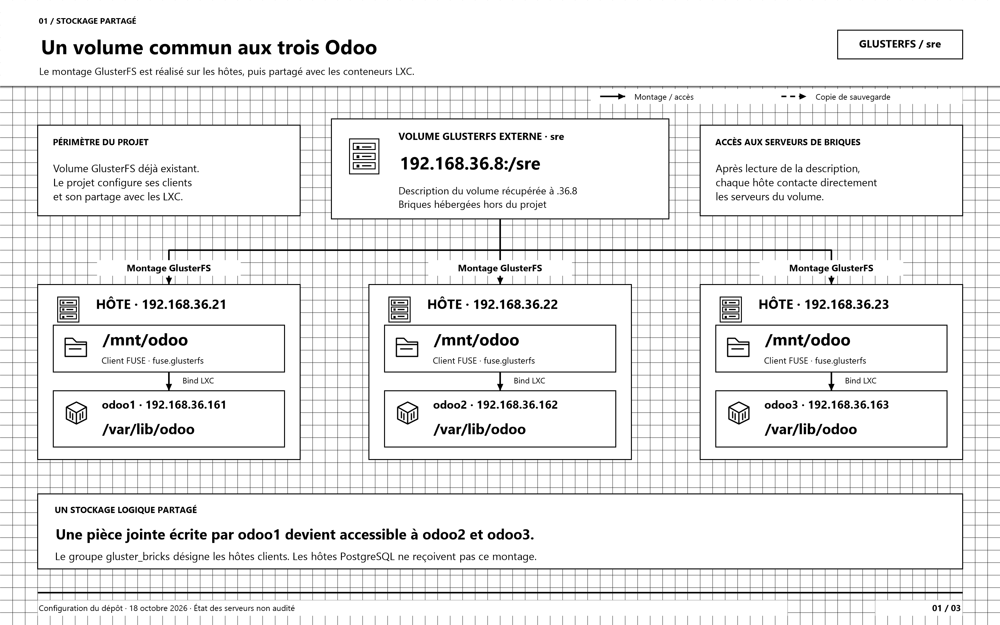
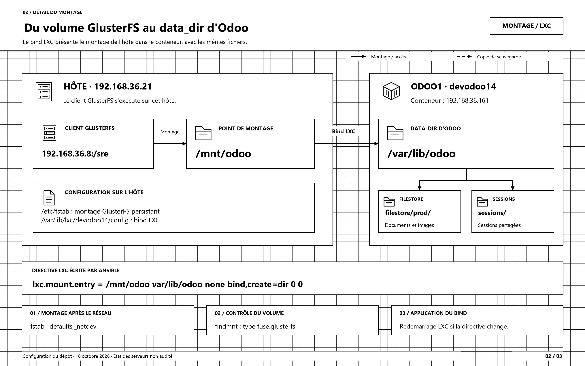
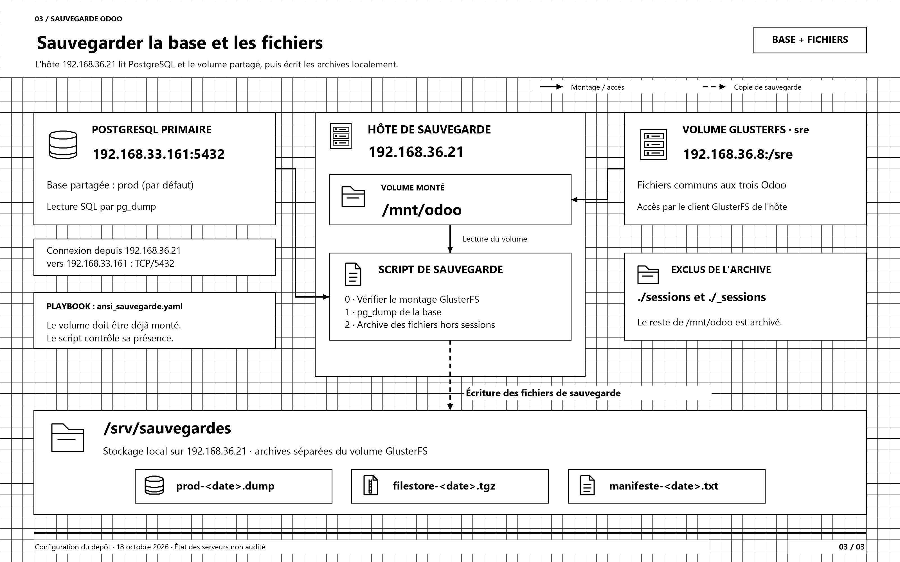

# Schémas GlusterFS du projet Odoo

Configuration du dépôt au 18 octobre 2026. Les schémas décrivent les montages prévus par Ansible ; ils ne vérifient pas l'état des serveurs.

Ouvrir [architecture-glusterfs-professionnelle.drawio](architecture-glusterfs-professionnelle.drawio) dans draw.io / diagrams.net ou dans l'extension Draw.io de VS Code. Le document contient trois onglets modifiables, en noir et blanc, avec icônes vectorielles et quadrillage visible de 20 unités.

| Vue | Aperçu PNG | Version SVG |
| --- | --- | --- |
| Volume partagé entre les trois Odoo | [PNG](01-volume-partage-trois-odoo.png) | [SVG](01-volume-partage-trois-odoo.svg) |
| Montage sur l'hôte et bind LXC | [PNG](02-montage-hote-et-bind-lxc.png) | [SVG](02-montage-hote-et-bind-lxc.svg) |
| GlusterFS et sauvegarde | [PNG](03-glusterfs-et-sauvegarde.png) | [SVG](03-glusterfs-et-sauvegarde.svg) |

## Lire les schémas

- Trait plein : montage ou accès logique aux données.
- Trait pointillé : écriture des fichiers de sauvegarde.
- La grille apparaît dans le document draw.io et dans les exports ; ses lignes sont verrouillées.
- Les icônes, textes et connecteurs sont des éléments vectoriels modifiables.
- Le volume sre est externe au projet. Le serveur 192.168.36.8 fournit sa description ; les clients joignent ensuite directement les serveurs de briques indiqués par cette description.
- Les hôtes .36.21, .36.22 et .36.23 montent tous le même volume sur /mnt/odoo. Le groupe gluster_bricks désigne ici ces clients.
- Le bind vers /var/lib/odoo couvre le data_dir complet. Les chemins filestore/prod et sessions y sont donc partagés.
- prod est le nom de base par défaut, surchargeable par PROSYS_ODOO_DB.
- La sauvegarde est exécutée sur .36.21, depuis le montage hôte. Elle exclut ./sessions et ./_sessions et écrit dans /srv/sauvegardes.
- Le rapatriement vers le contrôleur est facultatif et désactivé par défaut ; il est hors de la vue principale.

## Configuration représentée

| Élément | Valeur | Source |
| --- | --- | --- |
| Point d'entrée du volume | 192.168.36.8:/sre | [Variables communes](../../group_vars/all/vars.yml) |
| Montage sur les hôtes | /mnt/odoo | [Variables Gluster](../../group_vars/gluster_bricks/vars.yml) |
| Destination LXC | /var/lib/odoo | [Rôle de montage](../../roles/odoo_filestore/tasks/main.yaml) |
| Répertoire de données Odoo | /var/lib/odoo | [Variables Odoo](../../group_vars/odoo_containers/vars.yml) |
| Montage avant installation Odoo | Étape 1bis/5 | [Déploiement Odoo](../../playbooks/ansi_odoo.yaml) |
| Hôte et répertoire de sauvegarde | .36.21, /srv/sauvegardes | [Inventaire](../../inventory.yaml), [variables sauvegarde](../../group_vars/backup_host/vars.yml) |
| Ordre et exclusions des archives | pg_dump puis archive hors sessions | [Script de sauvegarde](../../roles/odoo_backup/templates/odoo-sauvegarde.sh.j2) |

Le rôle vérifie le type fuse.glusterfs sur l'hôte et dans le conteneur. Le montage représenté est la configuration cible ; les anciens montages éventuellement présents sur les serveurs n'ont pas été inspectés.

## Régénération

Depuis PowerShell sous Windows : .\generer-schemas.ps1

Le générateur utilise XML, SVG et System.Drawing, sans dépendance externe. Il produit les trois pages draw.io et les aperçus PNG 3200 × 2000 et SVG. Les modifications faites directement dans draw.io ne sont pas réimportées dans le générateur.
