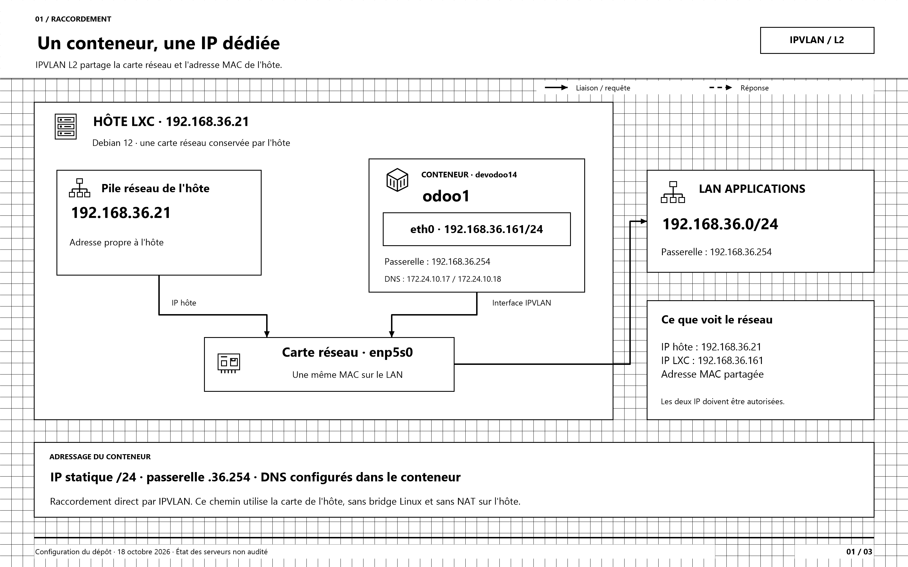
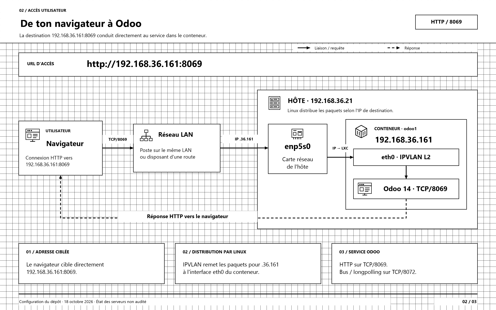
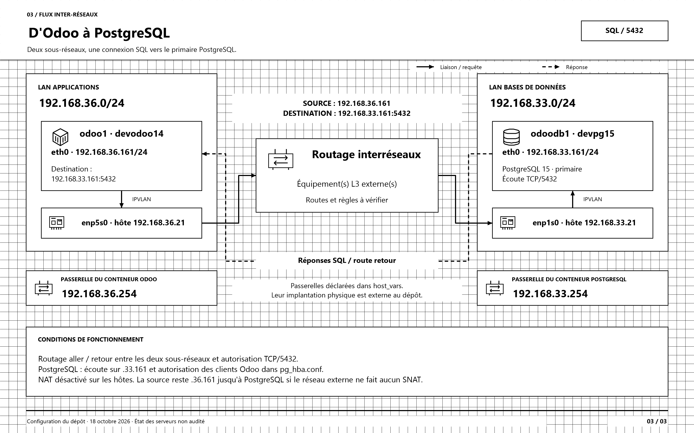

# Schémas réseau LXC

Les trois vues décrivent la configuration du dépôt au 18 octobre 2026. Elles ne constituent pas un contrôle des serveurs.

Ouvrir **architecture-lxc-professionnelle.drawio** avec draw.io / diagrams.net ou l'extension Draw.io de VS Code. Le fichier contient trois onglets en noir et blanc, avec quadrillage visible. Les formes, icônes vectorielles, textes et connecteurs sont modifiables.

| Vue | Aperçu | Format vectoriel |
| --- | --- | --- |
| Raccordement IPVLAN L2 | [PNG](01-raccordement-ipvlan.png) | [SVG](01-raccordement-ipvlan.svg) |
| Accès utilisateur à Odoo | [PNG](02-acces-utilisateur-odoo.png) | [SVG](02-acces-utilisateur-odoo.svg) |
| Flux Odoo vers PostgreSQL | [PNG](03-flux-odoo-postgresql.png) | [SVG](03-flux-odoo-postgresql.svg) |

## Lire les schémas

- Trait noir plein : raccordement ou requête vers le service.
- Trait noir pointillé : réponse vers le client.
- Quadrillage de 20 unités : visible dans draw.io et dans les exports, placé au fond et verrouillé.
- Icônes vectorielles : serveur en rack, conteneur, navigateur, réseau, carte réseau, routeur et base PostgreSQL.
- Contours des hôtes et conteneurs : limites logiques d'exécution.
- Les équipements de routage externes sont représentés sans inventer de switch, de VLAN ou de routeur physique.
- Les adresses MAC ne sont pas inventées : le conteneur partage celle de la carte parente.
- Le chemin représenté utilise IPVLAN L2. Un ancien lxcbr0 peut exister sur l'hôte, en dehors de ce chemin.

Le rôle ne permet pas une communication directe hôte / propre conteneur via l'interface IPVLAN parente. Faire les contrôles d'accès depuis un autre poste disposant de la route, ou utiliser lxc-attach sur l'hôte.

## Sources dans le dépôt

- [inventory.yaml](../../inventory.yaml) : lxc_net_type=ipvlan, lxc_egress_nat=false.
- [host_vars/192.168.36.21.yml](../../host_vars/192.168.36.21.yml) : carte, IP, passerelle et DNS d'odoo1.
- [host_vars/192.168.33.21.yml](../../host_vars/192.168.33.21.yml) : paramètres d'odoodb1.
- [roles/lxc_lan/defaults/main.yml](../../roles/lxc_lan/defaults/main.yml) : mode IPVLAN l2.
- [roles/lxc_lan/tasks/main.yaml](../../roles/lxc_lan/tasks/main.yaml) : configuration LXC et systemd-networkd.
- [group_vars/all/vars.yml](../../group_vars/all/vars.yml) : cible PostgreSQL et ports Odoo.

Le routage aller et retour, les autorisations TCP/5432 et l'éventuel SNAT dans le réseau externe doivent être vérifiés sur l'infrastructure.

## Régénérer les fichiers

Depuis PowerShell sous Windows : .\generer-schemas.ps1

Le script utilise uniquement XML, SVG et System.Drawing. Il génère le document draw.io, les SVG et les PNG 3200 × 2000 et vérifie les identifiants, les limites de page et la largeur des textes. Les modifications faites directement dans draw.io ne sont pas réimportées dans ce script.