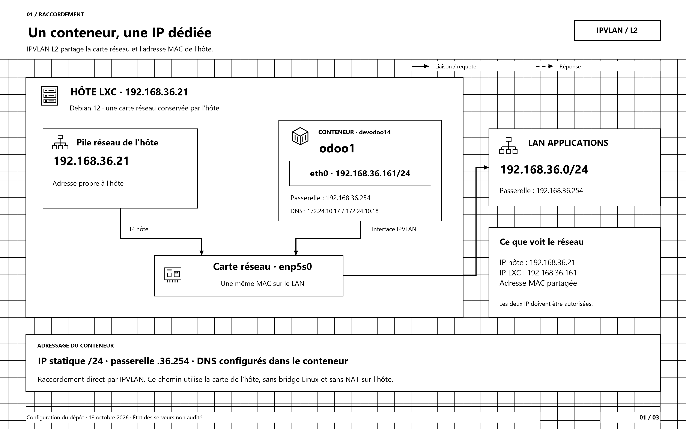
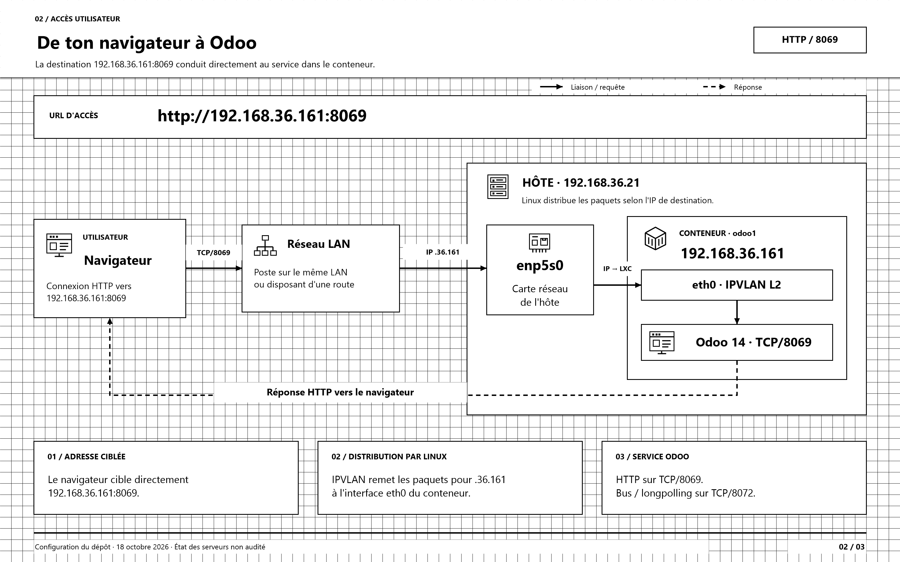
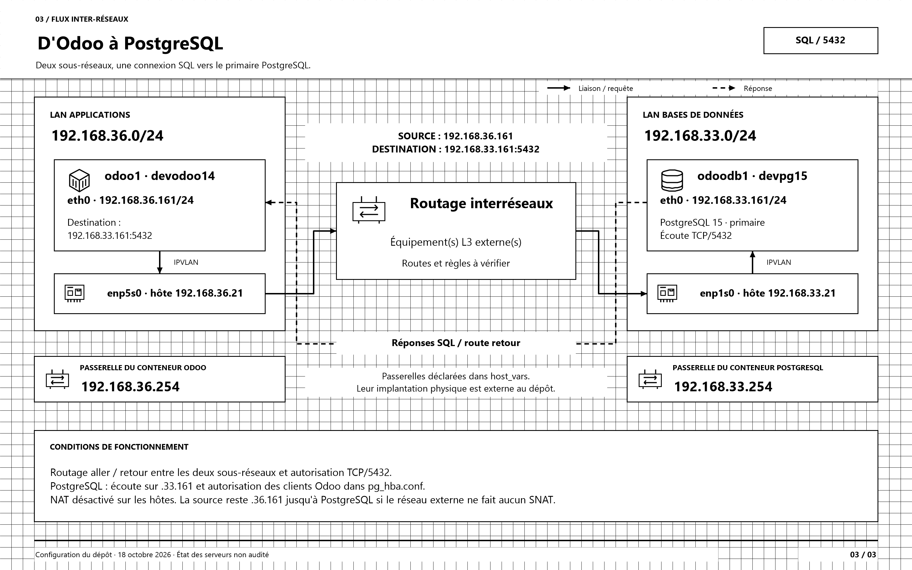

# Schémas réseau LXC

Les trois vues décrivent la configuration du dépôt au 18 octobre 2026. Elles ne constituent pas un contrôle des serveurs.

Ouvrir **architecture-lxc-professionnelle.drawio** avec draw.io / diagrams.net ou l'extension Draw.io de VS Code. Le fichier contient trois onglets en noir et blanc, avec quadrillage visible. Les formes, icônes vectorielles, textes et connecteurs sont modifiables.

| Vue | Aperçu | Format vectoriel |
| --- | --- | --- |
| Raccordement IPVLAN L2 | [PNG](01-raccordement-ipvlan.png) | [SVG](01-raccordement-ipvlan.svg) |
| Accès utilisateur à Odoo | [PNG](02-acces-utilisateur-odoo.png) | [SVG](02-acces-utilisateur-odoo.svg) |
| Flux Odoo vers PostgreSQL | [PNG](03-flux-odoo-postgresql.png) | [SVG](03-flux-odoo-postgresql.svg) |

## Explication de chaque schéma

Ces vues conservent la configuration du 18 octobre 2026. Pour les connexions SQL avec Patroni et HAProxy de l’édition récente, consulter le [dossier Patroni et Odoo 14](../schemas-patroni-odoo14/README.md).

### 01 — Raccordement IPVLAN L2

[Ouvrir le schéma](01-raccordement-ipvlan.svg).

**Objectif :** comprendre comment un conteneur rejoint le réseau à travers la carte de son hôte.

Le contour extérieur représente l’hôte ; le contour intérieur représente le conteneur. L’interface IPVLAN du conteneur est rattachée à l’interface parente de l’hôte. Le conteneur possède sa propre adresse IP, tout en partageant la MAC de cette interface parente.

**Parcours à suivre :** réseau externe → carte réseau de l’hôte → interface IPVLAN → conteneur. Le chemin représenté n’utilise pas de traduction d’adresse sur l’hôte. Un éventuel ancien bridge `lxcbr0` n’intervient pas dans ce parcours.

**À retenir :** l’adresse IP du conteneur doit être joignable depuis le réseau qui l’utilise. Pour contrôler cette accessibilité, utiliser un autre poste disposant de la route ; l’hôte ne communique pas directement avec son propre conteneur par l’interface IPVLAN parente. `lxc-attach` permet une inspection locale.

### 02 — Accès utilisateur à Odoo

[Ouvrir le schéma](02-acces-utilisateur-odoo.svg).

**Objectif :** suivre une requête du navigateur jusqu’au service Odoo.

L’utilisateur contacte l’adresse du conteneur Odoo sur le port `8069`. Les flèches pleines montrent la requête ; les pointillés montrent le retour vers le navigateur. Le port `8072` correspond au bus Odoo dans la configuration du projet.

**Parcours à suivre :** navigateur → réseau et routage nécessaires → IP du conteneur → service Odoo → réponse au navigateur. Le chemin retour doit être autorisé et correctement routé lui aussi.

**À retenir :** cette vue représente un accès direct à une instance. Elle ne fournit pas une adresse web commune ni un répartiteur HTTP pour les trois Odoo. Si l’accès échoue, distinguer l’accessibilité de l’IP, l’ouverture du port et l’état du service Odoo.

### 03 — Flux Odoo vers PostgreSQL

[Ouvrir le schéma](03-flux-odoo-postgresql.svg).

**Objectif :** expliquer la communication entre le réseau applicatif et le réseau des bases de données.

Odoo émet une connexion SQL vers PostgreSQL sur `5432`. Le routage externe assure le passage entre les sous-réseaux. La réponse PostgreSQL doit pouvoir revenir vers l’application ; les règles réseau et l’éventuel SNAT externe font partie de ce trajet.

**Parcours à suivre :** conteneur Odoo → passerelle et routage externe → conteneur PostgreSQL → retour de la réponse SQL. Ce flux est distinct de la connexion HTTP du navigateur : c’est Odoo qui dialogue avec la base.

**À retenir :** le dessin historique représente une cible PostgreSQL directe. Dans la série récente, Odoo joint les endpoints HAProxy sur `5000`, puis HAProxy contacte le primaire sur `5432`. Un accès web fonctionnel ne suffit donc pas à prouver que la connexion SQL fonctionne.

[Revenir au guide général des schémas](../README.md).

## Lire les schémas

- Trait noir plein : raccordement ou requête vers le service.
- Trait noir pointillé : réponse vers le client.
- Quadrillage de 20 unités : visible dans draw.io et dans les exports, placé au fond et verrouillé.
- Icônes vectorielles : serveur en rack, conteneur, navigateur, réseau, carte réseau, routeur et base PostgreSQL.
- Contours des hôtes et conteneurs : limites logiques d'exécution.
- Les équipements de routage externes sont représentés sans inventer de switch, de VLAN ou de routeur physique.
- Les adresses MAC ne sont pas inventées : le conteneur partage celle de la carte parente.
- Le chemin représenté utilise IPVLAN L2. Un ancien lxcbr0 peut exister sur l'hôte, en dehors de ce chemin.

Le rôle ne permet pas une communication directe hôte / propre conteneur via l'interface IPVLAN parente. Faire les contrôles d'accès depuis un autre poste disposant de la route, ou utiliser lxc-attach sur l'hôte.

## Sources dans le dépôt

- [inventory.yaml](../../inventory.yaml) : lxc_net_type=ipvlan, lxc_egress_nat=false.
- [host_vars/192.168.36.21.yml](../../host_vars/192.168.36.21.yml) : carte, IP, passerelle et DNS d'odoo1.
- [host_vars/192.168.33.21.yml](../../host_vars/192.168.33.21.yml) : paramètres d'odoodb1.
- [roles/reseau-lxc/lxc_lan/defaults/main.yml](../../roles/reseau-lxc/lxc_lan/defaults/main.yml) : mode IPVLAN l2.
- [roles/reseau-lxc/lxc_lan/tasks/main.yaml](../../roles/reseau-lxc/lxc_lan/tasks/main.yaml) : configuration LXC et systemd-networkd.
- [group_vars/all/vars.yml](../../group_vars/all/vars.yml) : cible PostgreSQL et ports Odoo.

Le routage aller et retour, les autorisations TCP/5432 et l'éventuel SNAT dans le réseau externe doivent être vérifiés sur l'infrastructure.

## Régénérer les fichiers

Depuis PowerShell sous Windows : .\generer-schemas.ps1

Le script utilise uniquement XML, SVG et System.Drawing. Il génère le document draw.io, les SVG et les PNG 3200 × 2000 et vérifie les identifiants, les limites de page et la largeur des textes. Les modifications faites directement dans draw.io ne sont pas réimportées dans ce script.
