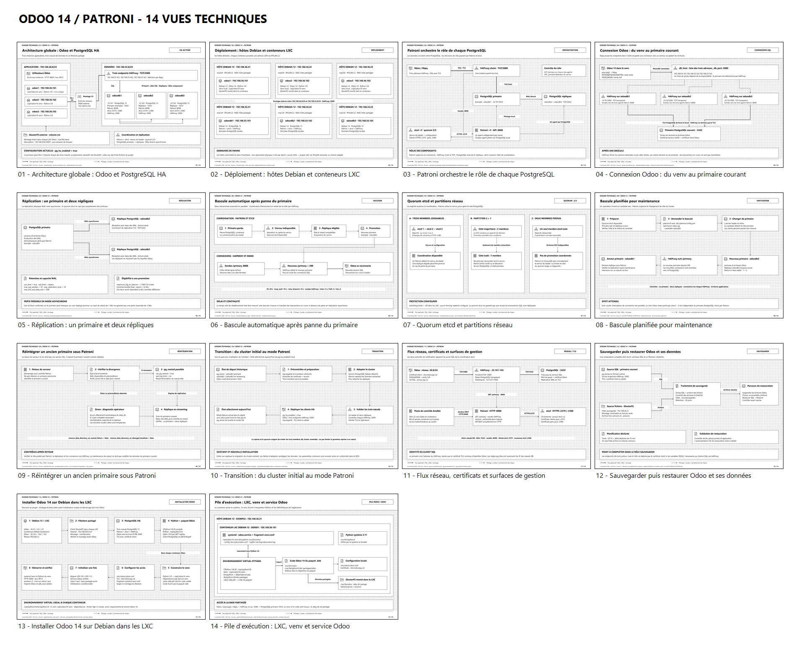
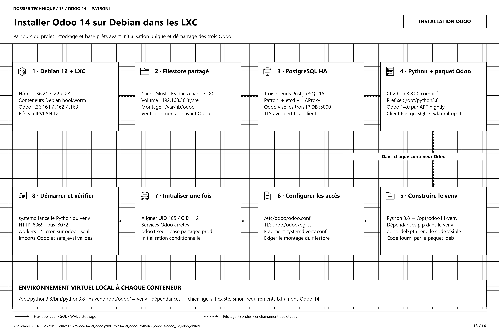
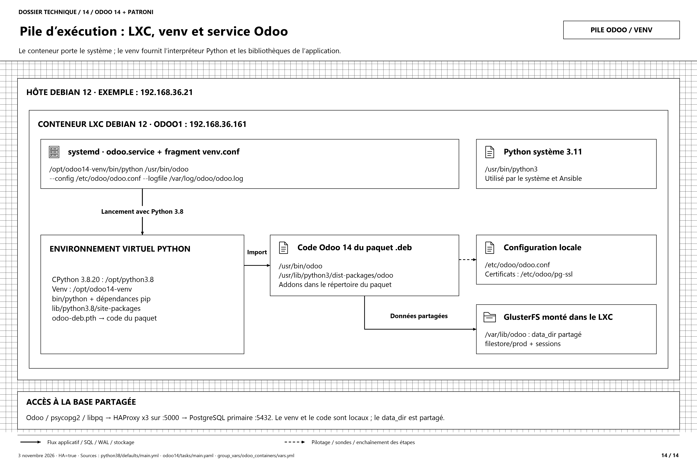

# Schémas professionnels — Patroni et Odoo 14

[Dossier draw.io complet : 14 onglets](dossier-patroni-odoo14.drawio) · [Installation Odoo : 2 onglets](installation-odoo14-debian-lxc.drawio) · [Planche des 14 vues](apercu-14-schemas.png)



Édition du **3 novembre 2026**, établie à partir des fichiers Ansible actuels. **`pg_ha_enabled: true`** est confirmé dans `group_vars/all/vars.yml`. Les scénarios de bascule utilisent odoodb1 puis odoodb2 à titre d’exemple ; ils ne déterminent pas le primaire réellement élu.

Le style reprend les documents du projet : noir et blanc, quadrillage de 20 unités, icônes vectorielles, limites d’hôtes et de conteneurs, connecteurs fléchés et textes éditables. Chaque page mesure **2400 × 1600** ; chaque PNG mesure **4800 × 3200**. Le SVG convient à l’impression ; les fichiers draw.io permettent les modifications.

## Catalogue

| Nº | Schéma | Image | Vectoriel | Modifiable |
| --- | --- | --- | --- | --- |
| 01 | Architecture globale : Odoo et PostgreSQL HA | [PNG](01-architecture-globale-ha.png) | [SVG](01-architecture-globale-ha.svg) | [draw.io](01-architecture-globale-ha.drawio) |
| 02 | Déploiement : hôtes Debian et conteneurs LXC | [PNG](02-deploiement-hotes-lxc.png) | [SVG](02-deploiement-hotes-lxc.svg) | [draw.io](02-deploiement-hotes-lxc.drawio) |
| 03 | Patroni orchestre le rôle de chaque PostgreSQL | [PNG](03-orchestration-patroni.png) | [SVG](03-orchestration-patroni.svg) | [draw.io](03-orchestration-patroni.drawio) |
| 04 | Connexion Odoo : du venv au primaire courant | [PNG](04-connexion-odoo-haproxy.png) | [SVG](04-connexion-odoo-haproxy.svg) | [draw.io](04-connexion-odoo-haproxy.drawio) |
| 05 | Réplication : un primaire et deux répliques | [PNG](05-replication-postgresql.png) | [SVG](05-replication-postgresql.svg) | [draw.io](05-replication-postgresql.drawio) |
| 06 | Bascule automatique après panne du primaire | [PNG](06-bascule-automatique.png) | [SVG](06-bascule-automatique.svg) | [draw.io](06-bascule-automatique.drawio) |
| 07 | Quorum etcd et partitions réseau | [PNG](07-quorum-et-partitions.png) | [SVG](07-quorum-et-partitions.svg) | [draw.io](07-quorum-et-partitions.drawio) |
| 08 | Bascule planifiée pour maintenance | [PNG](08-bascule-planifiee.png) | [SVG](08-bascule-planifiee.svg) | [draw.io](08-bascule-planifiee.drawio) |
| 09 | Réintégrer un ancien primaire sous Patroni | [PNG](09-retour-ancien-primaire.png) | [SVG](09-retour-ancien-primaire.svg) | [draw.io](09-retour-ancien-primaire.drawio) |
| 10 | Transition : du cluster initial au mode Patroni | [PNG](10-transition-vers-patroni.png) | [SVG](10-transition-vers-patroni.svg) | [draw.io](10-transition-vers-patroni.drawio) |
| 11 | Flux réseau, certificats et surfaces de gestion | [PNG](11-flux-reseau-et-tls.png) | [SVG](11-flux-reseau-et-tls.svg) | [draw.io](11-flux-reseau-et-tls.drawio) |
| 12 | Sauvegarder puis restaurer Odoo et ses données | [PNG](12-sauvegarde-et-restauration.png) | [SVG](12-sauvegarde-et-restauration.svg) | [draw.io](12-sauvegarde-et-restauration.drawio) |
| 13 | Installer Odoo 14 sur Debian dans les LXC | [PNG](13-installation-odoo14-debian-lxc.png) | [SVG](13-installation-odoo14-debian-lxc.svg) | [draw.io](13-installation-odoo14-debian-lxc.drawio) |
| 14 | Pile d’exécution : LXC, venv et service Odoo | [PNG](14-pile-execution-odoo14-venv.png) | [SVG](14-pile-execution-odoo14-venv.svg) | [draw.io](14-pile-execution-odoo14-venv.drawio) |

## Installation Odoo 14 dans les conteneurs





Le projet utilise **Debian 12 bookworm**, **CPython 3.8.20** compilé dans `/opt/python3.8` et un environnement virtuel **local à chaque LXC**, `/opt/odoo14-venv`. Le paquet Debian Odoo 14 fournit le code dans `/usr/lib/python3/dist-packages/odoo` et le lanceur `/usr/bin/odoo`. Le fichier `odoo-deb.pth` rend ce code accessible depuis le venv ; les dépendances Python sont installées dans le venv.

Le fragment `/etc/systemd/system/odoo.service.d/venv.conf` lance :

```text
/opt/odoo14-venv/bin/python /usr/bin/odoo --config /etc/odoo/odoo.conf --logfile /var/log/odoo/odoo.log
```

Le Python système 3.11 demeure utilisé par le système et Ansible. Les dépendances pip proviennent du fichier figé s’il existe, sinon du `requirements.txt` amont ; le répertoire de lock n’est pas présent dans la copie du dépôt examinée. L’installation aligne UID 105 et GID 112. L’initialisation de la base est conditionnelle et effectuée par **odoo1 seul**, services Odoo arrêtés, avant le démarrage commun. Odoo1 porte aussi le cron ; ce rôle applicatif est indépendant du primaire PostgreSQL.

Le playbook actif **monte directement GlusterFS dans chaque conteneur Odoo** sur `/var/lib/odoo`. Le volume porte `filestore/prod` et les sessions. Le montage hôte puis bind LXC appartient aux anciens documents. L’hôte de sauvegarde `192.168.36.21` conserve `/mnt/odoo` en lecture seule.

Sources : [playbook Odoo](../../playbooks/ansi_odoo.yaml), [montage dans les LXC](../../playbooks/filestore-conteneur.yaml), [Python 3.8](../../roles/ansi_odoo/python38/defaults/main.yml), [installation et systemd](../../roles/ansi_odoo/odoo14/tasks/main.yaml), [variables Odoo](../../group_vars/odoo_containers/vars.yml), [identités Unix](../../roles/ansi_odoo/odoo_uid/defaults/main.yml).

## Lecture des vues Patroni

- Trait plein : connexion applicative, SQL, WAL ou accès au stockage selon le libellé.
- Pointillés : pilotage, sondes ou enchaînement d’un scénario. Les liens d’un parcours d’installation expriment des étapes, pas des liaisons réseau.
- Les trois HAProxy sont présents dans les nœuds PostgreSQL. La représentation groupée des agents ou des proxies est une vue logique de plusieurs processus.
- Odoo utilise les trois adresses `192.168.33.161,192.168.33.162,192.168.33.163` sur **5000**, avec libpq et `PGTARGETSESSIONATTRS=read-write`. HAProxy conserve le TLS jusqu’au primaire PostgreSQL sur **5432**.
- Chaque HAProxy interroge `GET /primary` sur les trois API Patroni **HTTP/8008**. Un retour 200 désigne le primaire détenant le verrou. [Référence API Patroni](https://patroni.readthedocs.io/en/latest/rest_api.html).
- Les agents Patroni gèrent leur PostgreSQL local et utilisent etcd via **HTTPS/2379**. Les membres etcd échangent sur **HTTPS/2380** ; la majorité est **2 sur 3**. Ce quorum concerne la coordination, pas les acquittements WAL. [Pannes et partitions etcd](https://etcd.io/docs/v3.5/op-guide/failures/).
- La réplication WAL est **asynchrone**. `maximum_lag_on_failover=1048576` est un seuil d’éligibilité ; il ne garantit pas une perte maximale de 1 Mio. [Modes de réplication Patroni](https://patroni.readthedocs.io/en/latest/replication_modes.html).
- Les réglages déclarés sont `ttl=30`, `loop_wait=10`, `retry_timeout=10` et sondes HAProxy `inter=3s / fall=3 / rise=2`. Ils ne constituent pas un RTO mesuré. Les sessions et transactions ne sont pas transférées lors d’une bascule.
- Le watchdog est désactivé dans les LXC. Lors d’une perte de renouvellement du verrou, Patroni tente d’arrêter ou démoter son PostgreSQL ; cette vue ne promet pas un fencing matériel. [Watchdog Patroni](https://patroni.readthedocs.io/en/latest/watchdog.html).
- La réintégration utilise `pg_rewind` lorsque ses conditions sont réunies. Aucun effacement automatique du répertoire de données n’est configuré sur échec de rewind ou divergence de timelines. Une éventuelle réinitialisation complète est une action explicite qui remplace les données locales de la réplique. [pg_rewind PostgreSQL 15](https://www.postgresql.org/docs/15/app-pgrewind.html).
- La vue 10 présente la **transition historique** vers Patroni ; elle ne signifie pas que l’activation reste à réaliser. Les groupes d’inventaire `db_containers` et `db_replicas` décrivent le placement initial après adoption.
- La HA SQL ne déplace pas automatiquement le cron Odoo, le service web, ni le stockage GlusterFS.

Sources : [inventaire](../../inventory.yaml), [HA activée et endpoints](../../group_vars/all/vars.yml), [paramètres du cluster](../../roles/ansi_postgresql_ha/pg_ha/defaults/main.yml), [Patroni](../../roles/ansi_postgresql_ha/pg_ha/templates/patroni.yml.j2), [HAProxy](../../roles/ansi_postgresql_ha/pg_ha/templates/haproxy.cfg.j2), [documentation HA](../POSTGRESQL-PATRONI.md), [patronictl](https://patroni.readthedocs.io/en/latest/patronictl.html).

## Sauvegarde et restauration

La vue 12 montre les sources SQL et GlusterFS, l’archive dans `/srv/sauvegardes` et les étapes de restauration d’un ensemble cohérent. Le rôle déclare un timer à 02:15 avec un délai aléatoire de 10 minutes et une rétention de 30 jours.

**Point à compléter :** le rôle de sauvegarde prépare les endpoints HA et `.pgpass`, mais ne déploie pas le certificat client SQL ni les variables `PGSSL*`. Le chemin `pg_dump` via HAProxy doit être complété et validé. Une restauration HA automatisée et validée n’est pas fournie par le dépôt. Sources : [rôle sauvegarde](../../roles/ansi_sauvegarde/odoo_backup/tasks/main.yaml), [documentation Patroni du projet](../POSTGRESQL-PATRONI.md).

## Régénération et vérification

Depuis PowerShell sous Windows :

```powershell
powershell.exe -NoProfile -ExecutionPolicy Bypass -File .\docs\schemas-patroni-odoo14\generer-schemas.ps1
```

Le générateur, accompagné de composition.ps1 et finalisation.ps1, utilise `schemas.json`, XML, SVG et System.Drawing. Il produit les 14 exports dans chaque format, le dossier à 14 onglets, le dossier d’installation à 2 onglets et la planche de consultation. Il contrôle les identifiants, les ancrages, les limites de page et les débordements typographiques ; le résultat figure dans `verification.json`. Les retouches manuelles draw.io ne sont pas réimportées dans la source JSON.

Les fichiers décrivent la configuration du dépôt. La production des schémas n’interroge et ne modifie aucun service distant.
