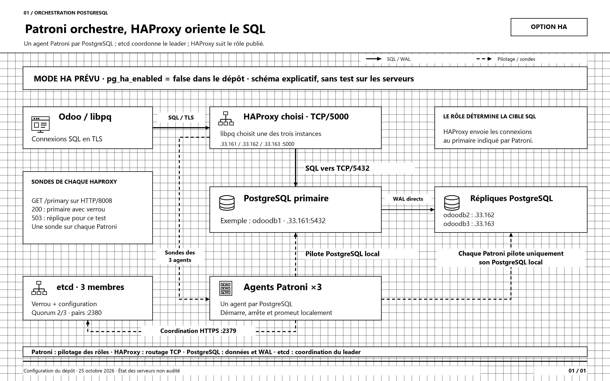

# Patroni dans l'orchestration de PostgreSQL et HAProxy

[Ouvrir le schéma draw.io modifiable](orchestration-patroni-haproxy-postgresql.drawio) · [PNG haute résolution](orchestration-patroni-haproxy-postgresql.png) · [SVG vectoriel](orchestration-patroni-haproxy-postgresql.svg)

Schéma explicatif du mode HA prévu dans le dépôt au **25 octobre 2026**. Le mode reste désactivé dans la configuration : pg_ha_enabled=false. Aucun service ni serveur n'a été modifié ou interrogé pour produire ce dessin.

Le style reprend les autres schémas : noir et blanc, icônes vectorielles, grille visible de 20 unités. Le dessin est une vue logique des rôles : le groupe des agents Patroni rassemble trois processus indépendants, un par nœud. Le HAProxy représenté est celui choisi parmi les trois instances, pas un répartiteur central unique.

## Comment lire les flèches

- **Trait plein épais :** les connexions SQL vont d'Odoo vers le HAProxy choisi sur 5000, puis vers le PostgreSQL primaire sur 5432. HAProxy conserve le TLS de bout en bout.
- **Trait plein fin, marqué WAL :** PostgreSQL réplique directement ses journaux vers ses deux répliques. Les WAL ne traversent pas les agents Patroni.
- **Pointillés, de HAProxy vers Patroni :** les sondes HTTP GET /primary sur 8008 ciblent les trois agents. 200 signifie PostgreSQL primaire avec verrou du leader ; une réplique saine répond 503 à ce contrôle. [API officielle Patroni](https://patroni.readthedocs.io/en/latest/rest_api.html)
- **Pointillés, de Patroni vers PostgreSQL :** chaque agent démarre, arrête, configure et promeut son PostgreSQL local. Aucun port réseau de pilotage local n'est inventé ; 8008 est l'API REST de Patroni.
- **Pointillés, de Patroni vers etcd :** les agents consultent le registre et acquièrent ou renouvellent le verrou du leader via HTTPS/2379. Les trois membres etcd échangent sur 2380 et exigent une majorité de deux.

## Qui fait quoi ?

| Composant | Rôle |
| --- | --- |
| PostgreSQL | Exécute les requêtes, conserve les données et réplique les WAL |
| Patroni | Supervise le PostgreSQL local et coordonne les changements de rôle à l'aide du verrou etcd |
| etcd | Conserve le verrou et la configuration du cluster ; son quorum concerne le consensus, pas les acquittements WAL |
| HAProxy | Observe le rôle publié par Patroni et route le SQL vers le primaire |
| libpq / Odoo | Essaie les trois endpoints HAProxy et ouvre une connexion au service disponible |

## Lors d'une panne

Le HAProxy retire la cible devenue indisponible et coupe les sessions qui lui étaient attachées. Les agents Patroni restants peuvent promouvoir une réserve éligible si le quorum etcd et les conditions de retard le permettent. Le HAProxy voit alors le nouveau primaire via son API Patroni ; les clients doivent ouvrir de nouvelles connexions SQL. Les transactions en cours ne sont pas transférées.

Le placement odoodb1 primaire et odoodb2/odoodb3 répliques est un exemple. La réplication reste asynchrone ; la présence d'un quorum etcd ne garantit pas zéro perte de transactions. Le projet désactive le watchdog matériel dans les LXC. Les délais réels et le scénario de panne restent à tester.

## Sources du projet

- [État HA et endpoints](../../group_vars/all/vars.yml).
- [Configuration HAProxy](../../roles/ansi_postgresql_ha/pg_ha/templates/haproxy.cfg.j2).
- [Configuration Patroni](../../roles/ansi_postgresql_ha/pg_ha/templates/patroni.yml.j2).
- [Paramètres etcd et Patroni](../../roles/ansi_postgresql_ha/pg_ha/defaults/main.yml).
- [Documentation PostgreSQL HA du projet](../POSTGRESQL-PATRONI.md).
- [Autres vues d'architecture et de bascule](../schemas-architecture-ha/README.md).

## Régénération

Depuis PowerShell sous Windows : .\generer-schema.ps1

Le générateur est autonome et utilise XML, SVG et System.Drawing. Il produit le document draw.io, le SVG et le PNG 3200 × 2000. Les retouches faites directement dans draw.io ne sont pas réimportées dans ce script.
